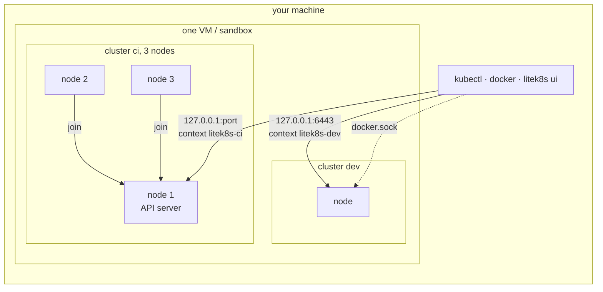
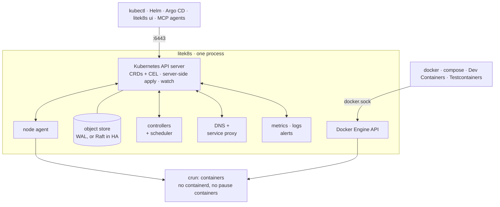
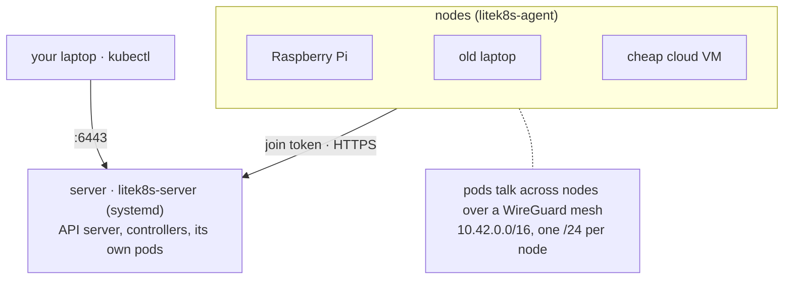
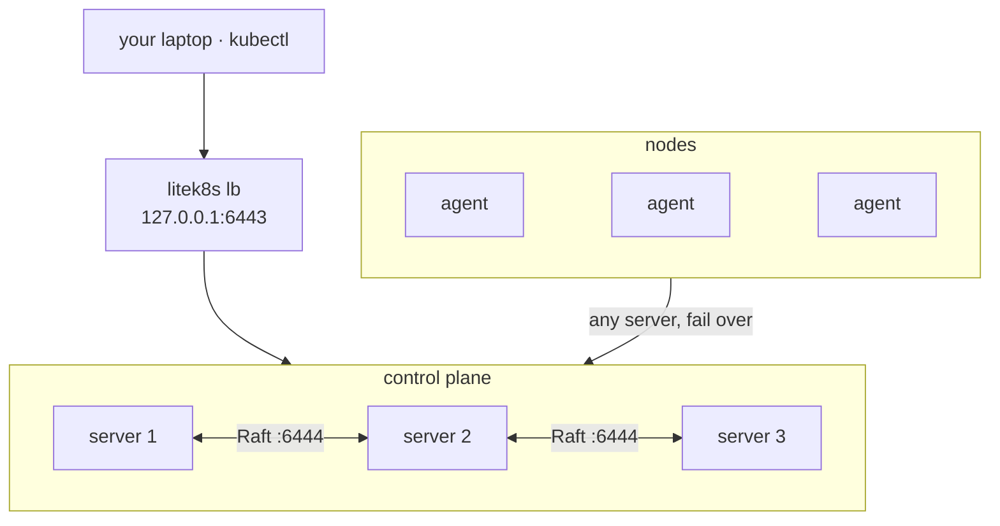

# litek8s

**[litek8s.dev](https://litek8s.dev)** · [docs](https://litek8s.dev/docs/) ·
[releases](https://github.com/jairoFernandez/litek8s/releases)

**A lightweight Kubernetes in one binary**, for local development, home
labs and the edge. It serves the real Kubernetes API, so `kubectl`, Helm
and Argo CD work unchanged, but the whole control plane, scheduler,
controllers, DNS, service proxy and node agent are one Rust process that
idles at about 20 MiB.

```bash
litek8s dev up        # a local cluster: ~0.2 s on Linux, ~1.3 s on macOS
kubectl get nodes     # context litek8s-dev, merged into ~/.kube/config
litek8s ui            # terminal UI for the cluster, containers and images
```

> **Status: early preview (v0.x).** Built and tested by one person; expect
> rough edges. There is no client authentication yet: keep the API on
> localhost or a trusted network ([Limitations](#limitations)).
> Feedback and issues are very welcome.

## Install

macOS (Apple silicon) and Linux (x86_64, aarch64), with Homebrew:

```bash
brew install jairoFernandez/tap/litek8s
```

or with the install script:

```bash
curl -fsSL https://raw.githubusercontent.com/jairoFernandez/litek8s/main/install.sh | sh
```

The script downloads the latest release for your OS and architecture, checks its
SHA-256, and installs `litek8s` to `~/.local/bin` (on macOS also the dev
VM's guest kernel and root image to `~/.local/share/litek8s/vm`). Options:
`LITEK8S_VERSION=v0.1.0`, `LITEK8S_INSTALL_DIR=/usr/local/bin`. Or
download an archive from the [releases page](https://github.com/jairoFernandez/litek8s/releases)
and check it against `SHA256SUMS`.

On Linux, dev clusters run rootless and need `crun`, `uidmap`, `passt`
(or `slirp4netns`), `iproute2` and `iptables`: `litek8s dev setup` checks
everything and says what is missing ([docs/dev.md](docs/dev.md#what-it-needs)).
macOS needs nothing else: no Docker Desktop, no Lima, no sudo.

Shell completion: Homebrew installs it; otherwise `litek8s completion zsh`
(or bash, fish, powershell, elvish) prints the script, e.g. `source <(litek8s
completion zsh)` in `~/.zshrc`.

From source: `cargo install litek8s` (crates.io) or `cargo install --git
https://github.com/jairoFernandez/litek8s` (Rust ≥ 1.90; macOS also needs the
guest, see [docs/dev.md](docs/dev.md)).

## Quickstart

```bash
litek8s dev up
kubectl create deployment web --image=nginx
kubectl expose deployment web --type=NodePort --port 80
curl localhost:$(kubectl get svc web -o jsonpath='{.spec.ports[0].nodePort}')

litek8s ui                                   # browse it all
export DOCKER_HOST=unix://$HOME/.litek8s/docker.sock
docker run --rm hello-world                  # the same cluster speaks the Docker API

litek8s dev up --name ci --nodes 3           # another cluster, three nodes
litek8s dev down                             # stop; objects and images are kept
litek8s dev delete                           # remove everything
```

Every cluster, and every node of a multi-node cluster, runs in one small
VM on macOS or one rootless sandbox on Linux, started with the first
cluster and stopped with the last. Each cluster gets its own API port,
kubectl context and Docker socket:



## Numbers

Measured against k3s, kind and k3d with the scripts in this repository; the
linked files have the setup, raw data and caveats.

| | litek8s | reference | source |
|---|---|---|---|
| Whole orchestrator, 5 nginx pods (PSS, 1 GiB arm64 VM) | **24.6 MiB** | k3s minimal: 603 MiB | [bench/RESULTS.md](bench/RESULTS.md#the-kubernetes-path-on-crun-without-docker-2026-10-17) |
| Argo CD + one synced app, orchestrator memory | **90 MiB** | k3s minimal: 900 MiB | [bench/RESULTS.md](bench/RESULTS.md#argo-cd-on-k3s-and-on-litek8s-2026-10-19-x86_64kvm) |
| `dev up` → node Ready, Linux / macOS | **0.17 s / 1.28 s** | kind 31.6 s / 34.3 s, k3d 11.1 s / 10.4 s | [bench/RESULTS.md](bench/RESULTS.md#local-dev-cluster-litek8s-dev-vs-kind-and-k3d-2026-10-18) |
| Dev cluster idle memory, Linux | **47 MiB** | kind 526 MiB, k3d 398 MiB | same |
| Metrics, logs and alerts, added memory | **+1.8 MiB** | kube-prometheus-stack + Loki: 1,371 MiB | [bench/RESULTS.md](bench/RESULTS.md#observability-built-in-vs-kube-prometheus-stack--loki-2026-10-20-x86_64kvm) |
| Compatibility corpus (kubectl, CRDs, workloads, networking, 47 Helm charts) | **119/119** | k3s: 119/119 | [compat/RESULTS.md](compat/RESULTS.md#without-docker-2026-10-19-119-cases) |
| Kubernetes v1.33 conformance (419 specs) | **413/419** | k3s: 416/419 | [compat/CONFORMANCE.md](compat/CONFORMANCE.md) |

The 6 conformance failures: 5 are macOS-only (TCP DNS on port 53, a
hostPort binding) and pass on Linux; 1 was a watch fixed since. A 3-server
HA control plane stays linearizable under leader kills and partitions
([bench/HA.md](bench/HA.md)); a 3-node cluster ran 21 h under churn with no
leak ([bench/SOAK.md](bench/SOAK.md)).

## What's in the binary

- **Dev clusters** (`litek8s dev`): kind/k3d/minikube without Docker. As
  many clusters as you like, each with as many nodes, in one rootless
  sandbox (Linux) or one small Virtualization.framework VM (macOS) that
  grows its memory on demand. NodePorts on `localhost`, your home directory mounted
  at the same path, `litek8s dev load` for local images. [docs/dev.md](docs/dev.md)
- **Docker Engine API** on `~/.litek8s/docker.sock`: `docker`,
  `docker compose`, `docker build`, Dev Containers and Testcontainers run
  on the dev cluster, next to (not instead of) Docker or OrbStack.
  [docs/docker.md](docs/docker.md)
- **Terminal UI** (`litek8s ui`): cluster state, a k9s-style Kubernetes
  view, containers by compose project with logs and shells, images,
  volumes, disk cleanup; keyboard-driven, works over SSH. [docs/ui.md](docs/ui.md)
- **Built-in observability**: an embedded time-series store with a
  Prometheus-compatible API (Grafana works), log search across every pod
  and node, alert rules to a webhook, ntfy or Telegram; `kubectl top`.
  [docs/observability.md](docs/observability.md)
- **Real servers and nodes**: `litek8s apiserver` on a box, more machines
  join with `litek8s agent --join ... --token ...` (k3s-style token that
  pins the CA), pods talk across nodes over a WireGuard mesh litek8s sets
  up itself. Pods run on crun directly: no containerd, no pause containers.
  [Multi-node](#multi-node-and-ha)
- **HA control plane**: 3 or 5 API servers share the store through Raft;
  no etcd. [docs/ha.md](docs/ha.md)
- **For LLM agents**: `litek8s mcp` is an MCP server (dev clusters, objects,
  pod diagnosis, logs, PromQL, alerts) with guardrails, and `litek8s skill`
  installs an agent skill: `claude mcp add litek8s -- litek8s mcp`.
  [docs/agents.md](docs/agents.md)
- **CRDs done properly**: OpenAPI schema validation, CEL rules type-checked
  and cost-estimated, ratcheting, server-side apply with managedFields.
  [docs/crds.md](docs/crds.md)

## How it works

One process does what a Kubernetes distribution splits across etcd, the
API server, the controller manager, the scheduler, CoreDNS, kube-proxy,
the kubelet and containerd, plus a Docker-compatible API and a metrics,
logs and alerts stack:



## Platforms

| | dev clusters | server / node (`apiserver`, `agent`) | release binary |
|---|---|---|---|
| **macOS, Apple silicon** (13+) | yes, in a VM (Virtualization.framework) | for development only (Docker runtime) | `darwin-arm64`, VM guest included |
| **Linux x86_64 / aarch64, rootless** | yes, user-namespace sandbox (kernel ≥ 5.11, cgroup v2) | – | `linux-x86_64`, `linux-aarch64` (static) |
| **Linux, root with crun** | yes | yes: the intended server and node setup | same |
| macOS Intel, Windows | no (WSL2 untested) | no | – |

Tested on Ubuntu 24.04 (arm64 and x86_64) and recent macOS on Apple
silicon. Ubuntu ≥ 23.10 needs `sudo litek8s dev setup` once (AppArmor and
unprivileged user namespaces).

## Multi-node and HA

A server runs the whole control plane and its own pods; any Linux machine
(a Raspberry Pi, an old laptop, a cheap cloud VM) joins it as a node with
the token the server prints:



On Linux servers (systemd, root), one command per machine, like k3s's
installer:

```bash
# the server (pods run here too); prints the join command and the kubeconfig path
curl -fsSL https://raw.githubusercontent.com/jairoFernandez/litek8s/main/install.sh | sh -s -- server

# every other machine: the command the server printed
curl -fsSL https://raw.githubusercontent.com/jairoFernandez/litek8s/main/install.sh | sh -s -- \
  agent --join https://192.168.1.10:6443 --token K10<hash>::<secret>
```

This installs `/usr/local/bin/litek8s` (and `crun`/`iptables` from the
package manager when missing), checks the machine (cgroup v2, kernel
WireGuard, free ports) and runs `litek8s install server|agent`: a systemd
unit (`litek8s-server` / `litek8s-agent`, `Restart=always`) with the token in
`/etc/litek8s/*.env`, kubeconfig in `/etc/litek8s/kubeconfig.yaml`. Pods keep
running across `systemctl restart` and upgrades, and come back after a
reboot. Extra flags go to `litek8s apiserver` / `litek8s agent` (e.g.
`--node-ip`); re-running replaces them. `sudo litek8s uninstall [--purge]`
removes it all.

Or do it all from your laptop over SSH (your `~/.ssh/config`, keys and
agent; sudo on the machines), for one machine or a whole cluster declared
in a file ([docs/clusters.md](docs/clusters.md)):

```bash
litek8s install server --ssh pi@192.168.1.10      # adds the kubeconfig context
litek8s install agent --ssh me@old-laptop --join https://192.168.1.10:6443 --token K10<hash>::<secret>

cat > cluster.yaml <<'EOF'
apiVersion: litek8s.dev/v1
kind: Cluster
metadata: {name: home}
servers: [{ssh: pi@192.168.1.10}]               # 1, or 3 for HA
agents:
  - {ssh: me@old-laptop, labels: {disk: ssd}}
  - {ssh: ubuntu@ec2-host, nodeIp: 10.0.0.7}
EOF
litek8s cluster apply -f cluster.yaml             # again: no-op; agent removed + --prune: drained, uninstalled
litek8s cluster status -f cluster.yaml
```

Without systemd, run the same processes yourself:

```bash
litek8s apiserver --listen 0.0.0.0:6443 --data-dir /var/lib/litek8s/apiserver --node-ip 192.168.1.10
litek8s agent --join https://192.168.1.10:6443 --token K10<hash>::<secret> --node-ip 192.168.1.21
```

Every node gets a `/24` of `10.42.0.0/16`; Services and DNS work
cluster-wide. A node that stops goes `NotReady` after 40 s and its pods are
rescheduled after their `tolerationSeconds`; laptops that sleep can join
with a longer `--node-grace-period`. Three servers make the control plane
highly available: `install.sh | sh -s -- server --cluster-init` on the first,
`... server --server https://<first>:6443 --token <token>` on two more
([docs/ha.md](docs/ha.md)). Any one server can die without losing writes;
`litek8s lb` gives kubectl one address in front of all three:



```bash
litek8s logs -l app=web --since 1h --grep ERROR
litek8s query 'topk(5, sum by (pod) (rate(container_cpu_usage_seconds_total[5m])))'
litek8s alerts
```

## Limitations

Honest list; more in [skills/litek8s/references/differences.md](skills/litek8s/references/differences.md).

- **No client authentication or RBAC enforcement.** Every API client is
  admin. Dev clusters listen on `127.0.0.1` only; on a server, put the API
  behind a firewall or VPN and do not expose port 6443 (or the Raft port,
  6444) to untrusted networks. Node join and HA peers are authenticated by
  the join token.
- One person's project, weeks old: APIs, flags and on-disk formats may
  change between 0.x releases without migration.
- Not every kubelet behavior: no `Unhealthy`/`BackOff` events, a memory
  `emptyDir` is one tmpfs per container mount; ValidatingAdmissionPolicy
  and webhook `matchConditions` are accepted but not enforced.
- Metrics cover containers, nodes and cluster state; application
  `/metrics` endpoints are not scraped (point a Prometheus at them).
- The macOS VM never returns memory to macOS once touched (a
  Virtualization.framework limit); litek8s keeps the guest small instead
  ([docs/dev.md](docs/dev.md#memory-on-macos)).
- macOS servers use Docker for pods and are meant for development; run
  real servers and nodes on Linux.
- Release binaries are built without the experimental `llm` feature
  ([docs/llm.md](docs/llm.md)).

## Documentation

[docs/dev.md](docs/dev.md) dev clusters ·
[docs/docker.md](docs/docker.md) Docker API ·
[docs/ui.md](docs/ui.md) terminal UI ·
[docs/observability.md](docs/observability.md) metrics, logs, alerts ·
[docs/ha.md](docs/ha.md) HA control plane ·
[docs/crds.md](docs/crds.md) CRDs ·
[docs/agents.md](docs/agents.md) MCP and agents ·
[compat/README.md](compat/README.md) compatibility corpus ·
[CONTRIBUTING.md](CONTRIBUTING.md) building and testing ·
[SECURITY.md](SECURITY.md) reporting vulnerabilities

## The legacy daemon

litek8s began as a small Docker-backed orchestrator with its own reduced
manifest format (`apiVersion: litek8s.dev/v1alpha1`), a daemon over a
Unix socket (`litek8s serve`) and SSH-backed remote nodes. It is still in
the binary but no longer the focus; see
[docs/legacy-daemon.md](docs/legacy-daemon.md).

## License

Apache-2.0, see [LICENSE](LICENSE) and [NOTICE](NOTICE). Third-party
components: [THIRD-PARTY.md](THIRD-PARTY.md).
