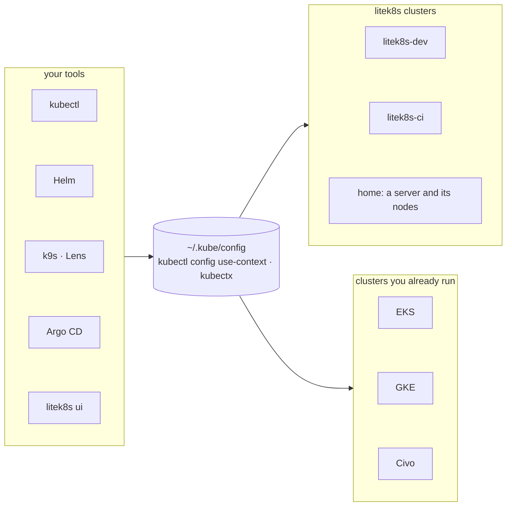

# litek8s next to the Kubernetes you already run

litek8s does not replace your clusters or your tools. It adds clusters to
the kubeconfig you already have, and everything that reads that file
(kubectl, Helm, k9s, Lens, Argo CD, `litek8s ui`) sees them next to your
EKS, GKE or Civo contexts. Switch with `kubectl config use-context` or
kubectx, as you do today.



## No lock-in, by construction

- **It only adds contexts.** `litek8s dev up` writes one context,
  `litek8s-dev` (`--name ci` adds `litek8s-ci`), into `~/.kube/config`
  and makes it current; `--no-switch` adds it without switching. A server
  installed with `litek8s install server --ssh` or `litek8s cluster apply`
  adds its own context the same way. Your other contexts are left as they
  are.
- **It is the Kubernetes API.** litek8s serves Kubernetes v1.33
  (`kubectl version` shows `v1.33.0+litek8s`): 119/119 on the compatibility
  corpus (kubectl workflows, CRDs, workloads, networking, 47 Helm charts)
  and 413/419 on the official conformance suite, where k3s scores 416/419
  ([compat/RESULTS.md](../compat/RESULTS.md),
  [compat/CONFORMANCE.md](../compat/CONFORMANCE.md)).
- **Same manifests, same charts, both ways.** What you apply to litek8s
  applies to any other cluster, and the other way round. There is no
  litek8s manifest format, no annotations you have to add, no SDK.
- **Going back is deleting it.** `litek8s dev delete` stops a dev cluster
  and removes its data and its context (`--name <n>` for each other one;
  `litek8s dev list` shows them), then `brew uninstall litek8s`. On a
  server, `sudo litek8s uninstall --purge`. Nothing to migrate: your
  manifests and charts never lived in litek8s.

## kubectl

litek8s does not ship kubectl; use the one you have, or install it:

```bash
brew install kubectl          # macOS, or Linux with Homebrew
```

or the official packages from pkgs.k8s.io
([Install tools](https://kubernetes.io/docs/tasks/tools/)). Keep it within
one minor version of the server, as Kubernetes recommends for any cluster:
**1.32 to 1.34** for litek8s's 1.33. Helm, k9s, Lens, kubectx and Argo CD
need nothing special either.

## `litek8s ui` on your other clusters

The terminal UI works on any conformant cluster through the same
kubeconfig, credentials included: tokens, client certificates and exec
plugins such as `gke-gcloud-auth-plugin`, `aws eks get-token` or
`kubelogin` ([ui.md](ui.md#read-only-clusters)).

- **Read-only by default** for every context that is not a litek8s
  cluster: list, describe, YAML, logs, the object tree and port-forwards
  work; deletes, edits, applies, scaling, shells and the like are refused.
  To allow changes on one, list it in `ui.yaml` (`writableContexts:
  [staging]`); a per-context switch in the UI itself is being added.
- **litek8s-only:** Observe (built-in metrics, log search and alerts)
  reads the litek8s API server's own metrics, and Home shows the dev VM or
  sandbox. On other clusters you get the Kubernetes view; the Docker views
  (containers, images, volumes) follow your Docker context, not the
  kube context.

## What's different from upstream

litek8s is an early preview with a few gaps compared with upstream
Kubernetes, most notably no client authentication or RBAC enforcement yet:
see [Limitations](limitations.md).
