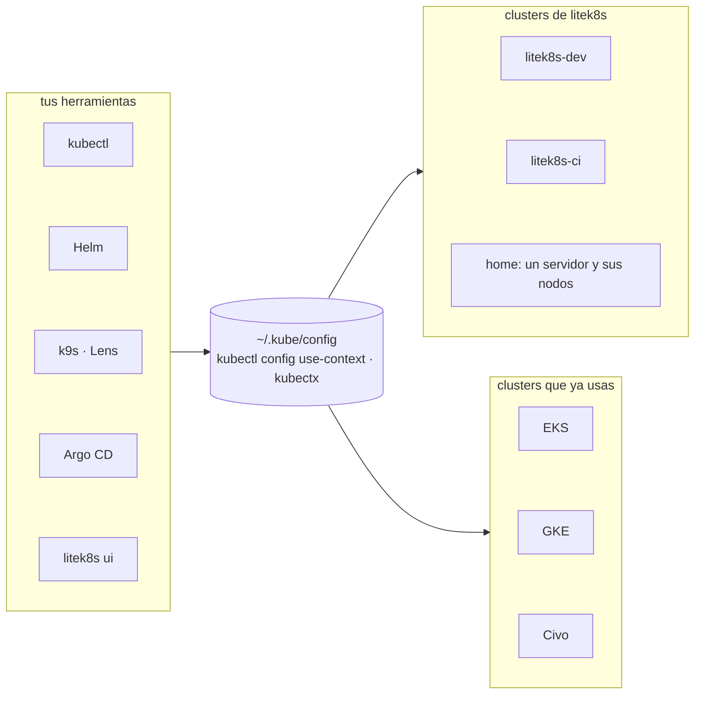

# litek8s junto al Kubernetes que ya usas

litek8s no reemplaza tus clusters ni tus herramientas. Agrega clusters al
kubeconfig que ya tienes, y todo lo que lee ese archivo (kubectl, Helm, k9s,
Lens, Argo CD, `litek8s ui`) los ve junto a tus contextos de EKS, GKE o Civo.
Cambia de uno a otro con `kubectl config use-context` o kubectx, como haces hoy.



## Sin lock-in, por diseño

- **Solo agrega contextos.** `litek8s dev up` escribe un contexto,
  `litek8s-dev` (`--name ci` agrega `litek8s-ci`), en `~/.kube/config` y lo
  vuelve el actual; `--no-switch` lo agrega sin cambiar de contexto. Un
  servidor instalado con `litek8s install server --ssh` o con
  `litek8s cluster apply` agrega su propio contexto de la misma forma. Tus
  otros contextos quedan como están.
- **Es la API de Kubernetes.** litek8s sirve Kubernetes v1.33
  (`kubectl version` muestra `v1.33.0+litek8s`): 119/119 en el corpus de
  compatibilidad (flujos de kubectl, CRDs, workloads, redes, 47 charts de Helm)
  y 413/419 en la suite oficial de conformidad, donde k3s obtiene 416/419
  ([compat/RESULTS.md](../../compat/RESULTS.md),
  [compat/CONFORMANCE.md](../../compat/CONFORMANCE.md)).
- **Mismos manifiestos, mismos charts, en ambas direcciones.** Lo que aplicas a
  litek8s se aplica a cualquier otro cluster, y viceversa. No hay un formato de
  manifiesto de litek8s, ni anotaciones que tengas que agregar, ni SDK.
- **Volver atrás es borrarlo.** `litek8s dev delete` detiene un cluster de
  desarrollo y elimina sus datos y su contexto (`--name <n>` para cada uno de
  los otros; `litek8s dev list` los muestra), y luego `brew uninstall litek8s`.
  En un servidor, `sudo litek8s uninstall --purge`. Nada que migrar: tus
  manifiestos y charts nunca vivieron en litek8s.

## kubectl

litek8s no incluye kubectl; usa el que tienes, o instálalo:

```bash
brew install kubectl          # macOS, or Linux with Homebrew
```

o los paquetes oficiales de pkgs.k8s.io
([Install tools](https://kubernetes.io/docs/tasks/tools/)). Mantenlo a no más
de una versión menor de distancia del servidor, como recomienda Kubernetes para
cualquier cluster: **1.32 a 1.34** para el 1.33 de litek8s. Helm, k9s, Lens,
kubectx y Argo CD tampoco necesitan nada especial.

## `litek8s ui` en tus otros clusters

La interfaz de terminal funciona en cualquier cluster conforme a través del
mismo kubeconfig, credenciales incluidas: tokens, certificados de cliente y
plugins exec como `gke-gcloud-auth-plugin`, `aws eks get-token` o `kubelogin`
([ui.md](../ui.md#clusters-de-solo-lectura)).

- **Solo lectura por defecto** en todo contexto que no sea un cluster de
  litek8s: listar, describe, YAML, logs, el árbol de objetos y los
  port-forwards funcionan; borrar, editar, aplicar, escalar, abrir shells y
  similares se rechazan. Para permitir cambios en uno, agrégalo a `ui.yaml`
  (`writableContexts: [staging]`); se está agregando un interruptor por
  contexto en la propia UI.
- **Solo en litek8s:** Observe (métricas, búsqueda de logs y alertas
  integradas) lee las métricas propias del API server de litek8s, y Home
  muestra la VM o el sandbox de desarrollo. En otros clusters tienes la vista
  de Kubernetes; las vistas de Docker (contenedores, imágenes, volúmenes)
  siguen tu contexto de Docker, no el contexto de kube.

## Qué cambia frente a upstream

litek8s es una preview temprana con algunas carencias frente al Kubernetes de
upstream, entre ellas una autenticación y un RBAC más simples (sin OIDC, sin
autorizador Node): ver [Limitaciones](../limitations.md).
