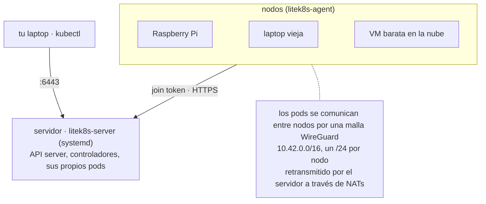
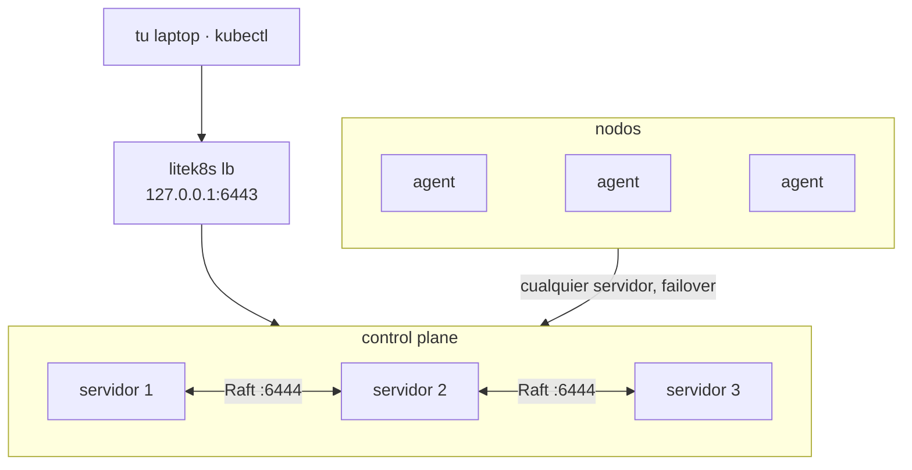

# Multinodo y HA

Un servidor corre todo el control plane y sus propios pods; cualquier máquina
Linux (una Raspberry Pi, una laptop vieja, una VM barata en la nube) se une a
él como nodo con el token que imprime el servidor:



En servidores Linux (systemd, root), un comando por máquina, como el instalador
de k3s:

```bash
# the server (pods run here too); prints the join command and the kubeconfig path
curl -fsSL https://raw.githubusercontent.com/jairoFernandez/litek8s/main/install.sh | sh -s -- server

# every other machine: the command the server printed
curl -fsSL https://raw.githubusercontent.com/jairoFernandez/litek8s/main/install.sh | sh -s -- \
  agent --join https://192.168.1.10:6443 --token K10<hash>::<secret>
```

Esto instala `/usr/local/bin/litek8s` (y `crun`/`iptables` desde el gestor de
paquetes si faltan), revisa la máquina (cgroup v2, WireGuard en el kernel,
puertos libres) y ejecuta `litek8s install server|agent`: una unidad de systemd
(`litek8s-server` / `litek8s-agent`, `Restart=always`) con el token en
`/etc/litek8s/*.env` y el kubeconfig en `/etc/litek8s/kubeconfig.yaml`. Los pods
siguen corriendo durante un `systemctl restart` y las actualizaciones, y vuelven
después de un reinicio. Los flags adicionales van a `litek8s apiserver` /
`litek8s agent` (p. ej. `--node-ip`); volver a ejecutarlo los reemplaza.
`sudo litek8s uninstall [--purge]` lo elimina todo.

O hazlo todo desde tu laptop por SSH (tu `~/.ssh/config`, tus llaves y tu
agente; sudo en las máquinas), para una sola máquina o para un cluster completo
declarado en un archivo ([clusters.md](../clusters.md)):

```bash
litek8s install server --ssh pi@192.168.1.10      # adds the kubeconfig context
litek8s install agent --ssh me@old-laptop --join https://192.168.1.10:6443 --token K10<hash>::<secret>

cat > cluster.yaml <<'EOF'
apiVersion: litek8s.dev/v1
kind: Cluster
metadata: {name: home}
servers: [{ssh: pi@192.168.1.10}]               # 1, or 3 for HA
agents:
  - {ssh: me@old-laptop, labels: {disk: ssd}}
  - {ssh: ubuntu@ec2-host, nodeIp: 10.0.0.7}
EOF
litek8s cluster apply -f cluster.yaml             # again: no-op; agent removed + --prune: drained, uninstalled
litek8s cluster status -f cluster.yaml
```

Sin systemd, corre tú mismo los mismos procesos:

```bash
litek8s apiserver --listen 0.0.0.0:6443 --data-dir /var/lib/litek8s/apiserver --node-ip 192.168.1.10
litek8s agent --join https://192.168.1.10:6443 --token K10<hash>::<secret> --node-ip 192.168.1.21
```

Cada nodo recibe un `/24` de `10.42.0.0/16`; los Services y el DNS funcionan en
todo el cluster. Los nodos detrás de NAT no necesitan VPN ni redirección de
puertos: dos casas se alcanzan directamente cuando sus routers lo permiten, y un
par sin camino directo pasa por un relay, por defecto el servidor (una VM en la
nube con dirección pública: `--node-external-ip`), con el camino de datos en el
kernel ([networking.md](../networking.md)). Un nodo que se detiene pasa a
`NotReady` después de 40 s y sus pods se reprograman después de sus
`tolerationSeconds`; las laptops que entran en suspensión pueden unirse con un
`--node-grace-period` más largo. Tres servidores hacen que el control plane sea
de alta disponibilidad: `install.sh | sh -s -- server --cluster-init` en el
primero, `... server --server https://<first>:6443 --token <token>` en otros dos
([ha.md](../ha.md)). Cualquiera de los servidores puede caerse sin que se
pierdan escrituras; `litek8s lb` le da a kubectl una sola dirección delante de
los tres:


