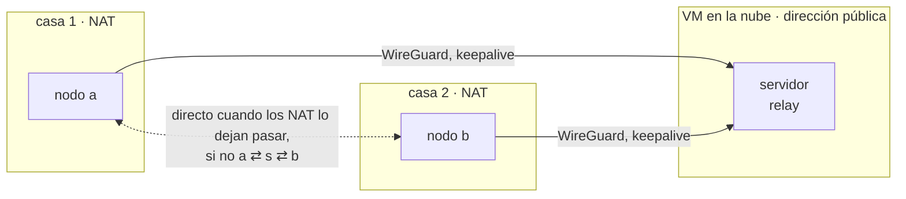

# Red entre nodos

Los pods en distintos nodos se comunican a través de una malla WireGuard del
kernel que litek8s configura por sí mismo: cada nodo recibe un `/24` del CIDR
del cluster (`10.42.0.0/16` por defecto) y una interfaz `litek8s-wg`, con cada
uno de los demás nodos como peer cuyas allowed IPs son el pod CIDR de ese nodo.
Las direcciones de los pods nunca se enmascaran (masquerade) entre nodos, así
que un pod ve la dirección real del pod que le habla, y los Services hacen DNAT
directamente a pods en otros nodos.

Las máquinas de casa suelen estar detrás de NAT, y una VM barata en la nube a
menudo tiene solo una dirección privada propia. litek8s maneja eso sin una VPN
delante:

- cada peer tiene un keepalive de 25 s, así que un nodo al que nadie puede
  llegar igual funciona: envía primero, y WireGuard aprende de dónde vienen
  sus paquetes;
- los endpoints vistos desde otros nodos se ofrecen como endpoints extra para
  probar, así que una casa cuyo router reenvía el puerto de WireGuard, o lo
  mapea igual para todos los destinos, es alcanzada directamente por los demás
  nodos;
- un par de nodos sin ningún camino directo pasa por un **relay**, un nodo al
  que ambos llegan.



## Relays

Por defecto los servidores hacen de relay (los nodos con el label
`node-role.kubernetes.io/control-plane`, que tiene el propio nodo de
`litek8s apiserver`). Ponle un label a otros nodos para que también hagan de
relay, o para dejar fuera a un servidor:

```bash
kubectl label node my-cloud-vm litek8s.dev/relay=true
kubectl label node my-server litek8s.dev/relay=false
```

El camino de datos se queda en el kernel. Cuando `a` y `b` no tienen camino
directo y el relay `s` llega a ambos:

- en `a`, el peer `s` recibe el pod CIDR de `b` en sus allowed IPs (y la
  entrada propia de `b`, ninguna); lo mismo en `b` para `a`;
- `s` descifra, su tabla de ruteo devuelve el paquete a `litek8s-wg`, y
  WireGuard lo cifra hacia el otro nodo.

Cada relay reenvía solo entre peers de WireGuard y solo entre direcciones de
pods (cadena de filtro `LITEK8S-OVERLAY`: `-i litek8s-wg -o litek8s-wg -s
<cluster CIDR> -d <cluster CIDR> -j ACCEPT`, todo lo demás que venga del
overlay de vuelta hacia él se descarta; los nodos que no hacen de relay lo
descartan todo). Los peers son los nodos del cluster, que se unieron con el
token, y WireGuard acepta de cada uno solo sus propias direcciones de pods (o,
a través de un relay, las de los nodos que están detrás), así que el relay no
es un reenviador abierto.

El relay de un par es el mismo visto desde ambos lados (las respuestas tienen
que volver por donde fue el tráfico, o WireGuard las descarta), elegido por
rendezvous hashing entre los relays a los que llegan ambos lados: los pares se
reparten entre los relays y no se mueven cuando se agrega otro relay.

## Cómo se entera un nodo

Cada agente observa a sus peers cada 10 s, y le envía a cada peer al que rutea
directamente un pequeño datagrama UDP por WireGuard (a la dirección de overlay
del peer, puerto 9): WireGuard responde a un paquete de datos con un keepalive
en menos de 10 s, así que un camino que funciona lleva tráfico en ambos
sentidos (los keepalives por sí solos terminan siendo unilaterales: un paquete
recibido pospone el del otro lado).

| estado | significado |
|---|---|
| `direct` | ruteado directamente: llegó algo en los últimos 40 s por una sesión con menos de 180 s; con relay: se completó un handshake en la entrada directa desde que el par pasó por relay |
| `unreachable` | observado durante 40 s sin eso |
| `unknown` | observado durante menos de 40 s (recién arrancado, o la ruta acaba de cambiar); se conserva el último estado conocido |

Lo reporta al servidor, que lo guarda en el objeto Node (así cada servidor de
un control plane HA calcula las mismas rutas a partir de los mismos objetos) y
calcula las rutas:

- un par pasa por relay solo cuando un lado reporta al otro como
  `unreachable`: los pares que funcionan directamente nunca pasan por relay;
- vuelve a directo cuando ningún lado lo reporta más. La entrada directa sigue
  configurada mientras está en relay, sin allowed IPs, así que sus keepalives
  siguen sondeando el camino;
- si no hay ningún relay al que lleguen ambos lados, el par se queda en su
  entrada directa (`unreachable` en las rutas).

Mientras un peer está en silencio, su agente prueba el siguiente de sus
endpoints conocidos cada 20 s: el que anuncia, aquellos en los que otros nodos
lo ven (de donde vienen sus paquetes, detrás de su NAT) y, para un servidor, la
dirección a la que el agente se conecta al API server. Un peer que logra pasar
conserva el endpoint que WireGuard aprendió de sus paquetes.

Eso alcanza a un nodo detrás de NAT siempre que su router deje entrar paquetes
de otros nodos: un port forward de UDP 51820, un mapeo full-cone, la misma LAN.
Entre dos NAT que no lo hacen, no hay hole punching con el que contar: los
routers Linux, por ejemplo, le dan un puerto nuevo a un flujo cuando un paquete
sin respuesta del otro lado llegó primero, así que ningún lado ve nunca
contestar al puerto al que envía. Un par así pasa por relay, lo que consume
ancho de banda del relay (en una VM en la nube, su egress); reenvía el puerto
en uno de los routers para hacerlo directo.

Los cambios van al kernel peer por peer (sin reemplazo de todo el dispositivo),
así que rutear un par de otra forma nunca reinicia las demás sesiones.

## Cómo verlo

Anotaciones en cada Node:

| anotación | escrita por | contenido |
|---|---|---|
| `litek8s.dev/wireguard-public-key`, `litek8s.dev/wireguard-endpoint` | el agente, al unirse | su clave y el endpoint que anuncia |
| `litek8s.dev/wireguard-peers` | el servidor, a partir de los reportes del agente | peer → `{"state": "direct", "endpoint": "203.0.113.7:51820"}` |
| `litek8s.dev/wireguard-routes` | el servidor | peer → `direct`, `via <relay>` o `unreachable` |

```bash
kubectl get node home-a -o jsonpath='{.metadata.annotations.litek8s\.dev/wireguard-routes}'
# {"cloud":"direct","home-b":"via cloud"}
litek8s tree
# ├─ nodes
# │  ├─ Node cloud   Ready, 3 pods, pods 10.42.0.0/24
# │  ├─ Node home-a  Ready, 2 pods, pods 10.42.1.0/24, overlay: home-b via cloud
```

Métricas, en la observabilidad integrada ([observability.md](../observability.md)),
por nodo:

| serie | |
|---|---|
| `litek8s_overlay_peer_receive_bytes_total{peer}`, `..._transmit_bytes_total{peer}` | contadores de WireGuard por peer |
| `litek8s_overlay_peer_last_handshake_age_seconds{peer}` | |
| `litek8s_overlay_peer_direct{peer}` | 1 directo, 0 inalcanzable |
| `litek8s_overlay_peer_relayed{peer,via}` | 1 cuando se llega a través de `via` |
| `litek8s_overlay_relayed_bytes_total` | en los relays: bytes reenviados para otros |

```bash
litek8s query 'rate(litek8s_overlay_relayed_bytes_total[5m])'
litek8s query 'litek8s_overlay_peer_relayed == 1'
```

## Una VM en la nube con IP pública

La dirección propia de una VM en la nube es privada (la pública es NAT 1:1).
Indícala con `--node-external-ip`: se convierte en el endpoint de WireGuard que
anuncia el nodo y en el `ExternalIP` del Node.

```bash
litek8s install server --node-external-ip 203.0.113.7       # or: litek8s apiserver ... --node-external-ip
litek8s install agent --join https://203.0.113.7:6443 --token ... --node-external-ip 198.51.100.4
```

Sin eso, los agentes igual prueban, para el nodo del servidor, la dirección a
la que se conectan al servidor, y el servidor aprende el endpoint público de
cada agente a partir de sus paquetes. Abre UDP 51820 (`--wireguard-port`) en el
security group de la VM.

## Services LoadBalancer en servidores y nodos

El status de un Service LoadBalancer apunta al `InternalIP` de un nodo, y cada
servidor y nodo escucha en los propios puertos del Service (TCP), no solo en
sus NodePorts, como el servicelb de k3s: el Service de un ingress controller en
80 y 443 responde en el 80 y el 443 de todas las máquinas, así que un registro
DNS o el `ExternalIP` de cualquier nodo llega a él. Abre esos puertos en el
security group de la VM. Un puerto que la máquina ya usa (el 22 de sshd, el
6443 de la API) se queda con su dueño y el agente de nodo lo registra en el
log; el NodePort sigue respondiendo, y el puerto se vuelve a intentar cada vez
que cambian los Services. Dos Services en un mismo puerto: se lo queda el
primero por namespace y nombre. `--disable-loadbalancer-ports` en `apiserver`
y `agent` conserva solo los NodePorts (el `--disable=servicelb` de k3s). Los
clusters de desarrollo, en cambio, publican ambos en el loopback del host
([dev.md](../dev.md)).

Un servidor con puertos de LoadBalancer les deja el 443: su API server no abre
ningún puerto extra dentro del cluster (`--in-cluster-port`, 443 en otro caso),
y los pods llegan a él a través del ClusterIP del Service `kubernetes`, que
reenvía a su propio puerto (6443). `--in-cluster-port 443` recupera el puerto
extra; un Service LoadBalancer en el 443 responde entonces solo en los demás
nodos.

## NetworkPolicies

Los nodos que ejecutan pods sobre crun aplican las NetworkPolicies con
iptables; no se necesita nada más (ni plugin CNI, ni controller de políticas).
El runtime de Docker (servidores macOS) no lo hace.

El API server hace la selección: para cada pod determina si alguna política lo
selecciona (ingress, egress o ambos, según `policyTypes` o su valor por
defecto: Egress solo para las políticas con reglas de egress) y qué está
permitido, como direcciones y números de puerto: los peers `podSelector` y
`namespaceSelector` se convierten en las IPs de los pods que coinciden (el
label `kubernetes.io/metadata.name` del namespace incluido), un `ipBlock` en
su CIDR con los rangos de `except` recortados, los puertos con nombre en el
número que el pod destino (ingress) o cada pod de destino (egress) le da a ese
nombre. Le envía a cada nodo las reglas de sus pods, recalculadas cuando
cambian los pods, los namespaces o las políticas (agrupadas cada 100 ms, solo
lo que cambió), y las reglas propias de un pod antes que el pod. El agente
carga las reglas de un pod cuando su sandbox obtiene su dirección, antes de que
arranque el primer contenedor, así que un pod seleccionado no tiene ni un
momento sin ellas.

En cada nodo, una cadena por cada dirección de pod aislado, detrás de
`LITEK8S-NETPOL`:

- `LITEK8S-FORWARD` salta a ella primero, y ve el tráfico entre pods del nodo
  (por el bridge; iptables lo ve a través de `br_netfilter` con
  `net.bridge.bridge-nf-call-iptables=1`, que el agente configura cuando
  aparece el primer pod aislado; los puertos de los pods en el bridge están en
  modo hairpin, como los configura el kubelet, así que un pod sigue
  llegándose a sí mismo a través de su propio Service), el tráfico que llega
  desde otros nodos y sale hacia ellos por el overlay, y el tráfico hacia
  cualquier cosa de afuera. El tráfico de Services se filtra después del DNAT
  del ClusterIP y antes del masquerade, así que se compara contra el backend
  real y el cliente real.
- `INPUT -i litek8s0` salta a ella: pods que le hablan al propio nodo, que es
  donde responden el DNS del cluster y el API server en el nodo donde corren.

Un paquete hacia un pod aislado pasa por su cadena de ingress, un paquete desde
uno por su cadena de egress (entre dos pods de un mismo nodo, por ambas): los
peers y puertos permitidos hacen return, todo lo demás se descarta. Las
respuestas (conntrack ESTABLISHED/RELATED) siempre pasan. Así, entre nodos, el
ingress se decide en el nodo de destino y el egress en el de origen.

El DNS del cluster no es un pod: lo responde el API server. Un peer de política
que seleccionaría a CoreDNS (`namespaceSelector` que coincide con
`kube-system`, o ninguno en una política de `kube-system`, y un `podSelector`
que coincide con `k8s-app: kube-dns`, o uno vacío) permite la dirección DNS del
resolv.conf de los pods; sus nombres de puerto son `dns` (UDP 53) y `dns-tcp`
(TCP 53). Una política de egress sin un peer así (o un ipBlock que contenga esa
dirección) deja al pod sin DNS, como en upstream. La regla habitual funciona
tal cual:

```yaml
egress:
  - to:
      - namespaceSelector: {matchLabels: {kubernetes.io/metadata.name: kube-system}}
        podSelector: {matchLabels: {k8s-app: kube-dns}}
    ports: [{port: 53, protocol: UDP}, {port: 53, protocol: TCP}]
```

Lo que no hace:

- El tráfico del nodo hacia sus propios pods siempre está permitido: las probes
  del kubelet, y los puertos NodePort y LoadBalancer, que litek8s retransmite
  desde un listener en el nodo (así que el pod ve al nodo como el cliente, y
  una política no puede distinguir a los clientes de un NodePort).
- Los pods con hostNetwork no son seleccionados ni son peers (como upstream lo
  deja abierto).
- Los conjuntos de peers siguen a los pods con un pequeño retraso: un pod nuevo
  es admitido por los demás una vez que su dirección se conoce y se envía
  (fail closed); una dirección liberada por un peer eliminado y asignada a un
  pod nuevo conserva los permisos del pod anterior hasta el siguiente envío
  (de milisegundos a un segundo).
- Un pod con `NET_ADMIN` puede enviar paquetes con la dirección de origen de
  otro pod en el bridge de su nodo (las respuestas no le vuelven).
- Solo IPv4; las reglas son de iptables (backend legacy o nft), una regla por
  (peer, puerto), suficiente para cientos de pods por política.

Las cadenas se eliminan junto con la dirección del pod (el agente las reescribe
cuando los pods se van) y con `litek8s uninstall` junto con todas las demás
cadenas `LITEK8S-*`. El cálculo y la generación de reglas tienen pruebas
unitarias (`src/kube/netpol.rs`, `src/kube/agent/netpol.rs`, el orden de envío
en `src/kube/agent/hub.rs`), y el nivel L3 de compat tiene cuatro casos de
políticas (`compat/cases/L3-networkpolicy.sh`).

Última ejecución (2026-10-29, `bench/cluster.sh up 2`: dos VMs Ubuntu 24.04
arm64 bajo qemu/HVF, crun): L3 11/11 y los casos de M1 que no son de caída con
br_netfilter activado; una verificación fijada con la base de datos en un nodo
y clientes permitidos y denegados en ambos; ninguna conexión desde un pod
denegado logró pasar mientras `litek8s-apiserver` (servidor y agente local) se
reiniciaba; todas las cadenas desaparecieron después de eliminar los pods.

## Cómo probarlo

`bench/nat-e2e.sh` levanta tres VMs: un servidor con dirección pública y dos
casas, cada una ejecutando su agente en un network namespace detrás de su
propio NAT (ambas casas en `10.99.0.0/24`). Comprueba que las casas, que no
pueden llegar una a la otra, pasan por el relay con pod a pod y Services
funcionando en ambos sentidos, bytes con relay en las métricas y en
`litek8s tree`; que un port forward en un router las vuelve directas sin nada
por relay; que cortar ese camino las devuelve al relay y restaurarlo, a
directo; y luego ejecuta los niveles M1 (multinodo) y M2 (relay) del corpus de
compat a través de los NAT.

Última ejecución (2026-10-21, omarchy: qemu + KVM, guests Ubuntu 24.04 amd64,
2 vCPU cada uno): las casas pasaron por relay 44 s después de que arrancaron
sus agentes, se volvieron directas 27 s después del port forward, volvieron a
tener tráfico por el relay 45 s después de que se cortó su camino y fueron
directas otra vez 141 s después de que volvió (el siguiente handshake en la
entrada directa); M1 5/5 y M2 2/2.

El cálculo de rutas, la observación, el diff de peers y las reglas tienen
pruebas unitarias (`src/kube/agent/relay.rs`, `src/kube/agent/overlay.rs`).

## Límites

- La detección no es instantánea: un camino que se rompe pasa por relay después
  de alrededor de un minuto (40 s sin respuestas, luego el siguiente reporte y
  envío); un camino que vuelve se usa de nuevo cuando un handshake logra pasar
  por él, lo que puede tardar hasta el siguiente rekey de WireGuard (2-3
  minutos).
- Un solo salto de relay: un par pasa por relay solo a través de un nodo al
  que ambos lados llegan directamente.
- Solo IPv4; un puerto de WireGuard por nodo.
- Todos los nodos de un cluster deben ejecutar un litek8s que reporte peers
  (0.2 y posteriores): un agente más antiguo nunca usa un relay.
