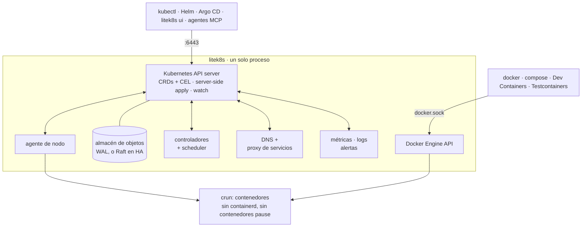

# litek8s: un Kubernetes liviano en un solo binario

**Un Kubernetes liviano en un solo binario**, para desarrollo local, home
labs y el edge. Sirve la API real de Kubernetes, así que `kubectl`, Helm y
Argo CD funcionan sin cambios, pero todo el control plane, el scheduler, los
controladores, el DNS, el proxy de servicios y el agente de nodo son un solo
proceso de Rust que en reposo ocupa 23 MiB en Linux (en macOS, más la pequeña
VM en la que corre).

```bash
litek8s dev up        # a local cluster: ~0.2 s on Linux, ~1.3 s on macOS
kubectl get nodes     # context litek8s-dev, merged into ~/.kube/config
litek8s ui            # terminal UI for the cluster, containers and images
```

> **Estado: preview temprana (v0.x).** Construido y probado por una sola
> persona; espera asperezas. Los servidores autentican a los clientes y aplican
> RBAC ([Autenticación y RBAC](../auth.md)); ver [Limitaciones](../limitations.md).
> Los comentarios y los issues son muy bienvenidos.

## Qué trae el binario

- **Clusters de desarrollo** (`litek8s dev`): kind/k3d/minikube sin Docker.
  Tantos clusters como quieras, cada uno con tantos nodos como quieras, en un
  solo sandbox rootless (Linux) o en una sola VM pequeña de
  Virtualization.framework (macOS) que aumenta su memoria según la demanda.
  NodePorts en `localhost`, tu directorio home montado en la misma ruta,
  `litek8s dev load` para imágenes locales. [dev.md](../dev.md)
- **API de Docker Engine** en `~/.litek8s/docker.sock`: `docker`,
  `docker compose`, `docker build`, Dev Containers y Testcontainers corren
  sobre el cluster de desarrollo, junto a (no en lugar de) Docker u OrbStack.
  [docker.md](../docker.md)
- **Interfaz de terminal** (`litek8s ui`): estado del cluster, una vista de
  Kubernetes al estilo de k9s, contenedores agrupados por proyecto de compose
  con logs y shells, imágenes, volúmenes, limpieza de disco; se maneja con el
  teclado y funciona por SSH. [ui.md](../ui.md)
- **Observabilidad integrada**: un almacén de series de tiempo embebido con una
  API compatible con Prometheus (Grafana funciona), búsqueda de logs en todos
  los pods y nodos, reglas de alerta hacia un webhook, ntfy o Telegram;
  `kubectl top`. [observability.md](../observability.md)
- **Servidores y nodos reales**: `litek8s apiserver` en una máquina; otras
  máquinas se unen con `litek8s agent --join ... --token ...` (un token al
  estilo de k3s que fija la CA), y los pods se comunican entre nodos por una
  malla WireGuard que litek8s configura por sí mismo. Los pods corren
  directamente sobre crun: sin containerd, sin contenedores pause.
  [Multinodo](../multi-node.md)
- **Control plane HA**: 3 o 5 API servers comparten el almacén mediante Raft;
  sin etcd. [ha.md](../ha.md)
- **Para agentes LLM**: `litek8s mcp` es un servidor MCP (clusters de
  desarrollo, objetos, diagnóstico de pods, logs, PromQL, alertas) con
  salvaguardas, y `litek8s skill` instala una skill para agentes:
  `claude mcp add litek8s -- litek8s mcp`. [agents.md](../agents.md)
- **CRDs bien hechos**: validación con esquemas OpenAPI, reglas CEL con
  verificación de tipos y estimación de costo, ratcheting, server-side apply
  con managedFields. [crds.md](../crds.md)

Caso de uso: **un solo LLM en todas tus máquinas**. Un modelo demasiado grande
para cualquiera de ellas corre en varias con el backend RPC de llama.cpp (un
DaemonSet de workers, un servidor compatible con OpenAI):
[examples/llm-rpc](../../examples/llm-rpc/README.md), [llm-cluster.md](../llm-cluster.md).

## Cómo funciona

Un solo proceso hace lo que una distribución de Kubernetes reparte entre etcd,
el API server, el controller manager, el scheduler, CoreDNS, kube-proxy, el
kubelet y containerd, además de una API compatible con Docker y un stack de
métricas, logs y alertas:



## Licencia

Apache-2.0, ver [LICENSE](../../LICENSE) y [NOTICE](../../NOTICE). Componentes
de terceros: [THIRD-PARTY.md](../../THIRD-PARTY.md).
