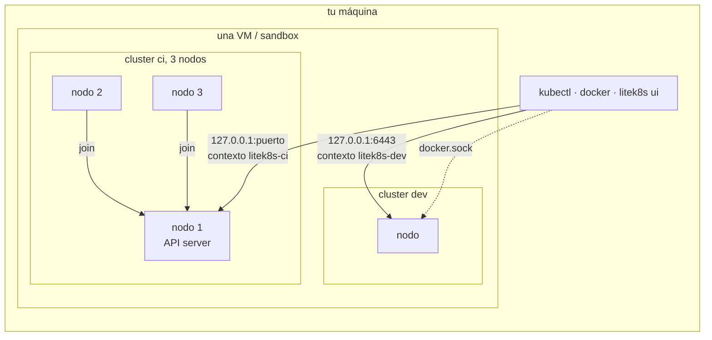

# Inicio rápido

```bash
litek8s dev up
kubectl create deployment web --image=nginx
kubectl expose deployment web --type=NodePort --port 80
curl localhost:$(kubectl get svc web -o jsonpath='{.spec.ports[0].nodePort}')

litek8s ui                                   # browse it all
export DOCKER_HOST=unix://$HOME/.litek8s/docker.sock
docker run --rm hello-world                  # the same cluster speaks the Docker API

litek8s dev up --name ci --nodes 3           # another cluster, three nodes
litek8s dev down                             # stop; objects and images are kept
litek8s dev delete                           # remove everything
```

Cada cluster, y cada nodo de un cluster multinodo, corre en una sola VM
pequeña en macOS o en un solo sandbox rootless en Linux, que arranca con el
primer cluster y se detiene con el último. Cada cluster tiene su propio puerto
de API, contexto de kubectl y socket de Docker:



## Tu propia imagen, sin registry

El socket de Docker y el cluster comparten un mismo almacén de imágenes, así que
una imagen que construyes sirve de inmediato como `image:` de un pod:

```bash
export DOCKER_HOST=unix://$HOME/.litek8s/docker.sock
DOCKER_BUILDKIT=0 docker build -t myapp:dev .   # litek8s's builder
kubectl create deployment myapp --image=myapp:dev
```

`DOCKER_BUILDKIT=0` funciona con cualquier CLI `docker`. Para construir con buildx
(Docker Desktop y OrbStack lo instalan) usa `docker build --load -t myapp:dev .`:
sin `--load`, buildx guarda la imagen en su propio builder y el cluster nunca la
ve. Ver [Builds](../docker.md#builds-dos-builders).
