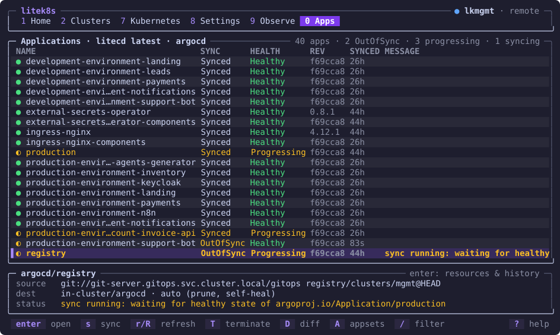
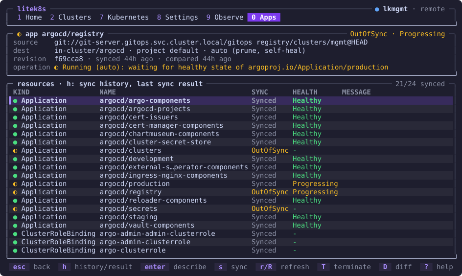

# GitOps with litecd

[litecd](https://github.com/ideascoldigital/litecd) is GitOps continuous
delivery in one small Rust binary that reads Argo CD's `Application`,
`AppProject` and `ApplicationSet` manifests unchanged and writes the same
`.status`. It is a separate project, built with litek8s as its first target:
on a cluster whose whole control plane fits in a few dozen MiB, Argo CD's
pods are the biggest thing running. litecd is that same GitOps loop in one
pod of single-digit MiB.

litek8s does not depend on litecd, and litecd uses only the public
Kubernetes API, so it runs on any conformant cluster. This page is about
running the two together.

## Why on litek8s

Side by side on one litek8s dev cluster with 20 Applications (each a
ConfigMap, a Service and a Deployment, automated sync with prune and
self-heal), from litecd's
[bench](https://github.com/ideascoldigital/litecd/blob/main/bench/RESULTS.md):

| | Argo CD v3.5.5 (5 pods) | litecd (1 pod) |
|---|---|---|
| Memory, no apps | 194 MiB | 2.2 MiB |
| Memory, 20 apps synced, idle | 310 MiB | 6.9 MiB |
| Memory, peak during a burst | 326 MiB | 9.4 MiB |
| CPU idle, 20 apps | 0.38 % of a CPU | 0.15 % |
| Install → ready | 28.7 s | 0.6 s |
| 19 apps at once → all Synced + Healthy | 5.7 s | 3.3 s |
| App created → Synced + Healthy (median) | 0.46 s | 0.46 s |

litek8s's [GitOps platform example](../examples/platform/README.md)
(12 Applications in waves, Helm charts, Kustomize, an app of apps that
manages itself, Gitea webhooks, CI, Atlantis) comes up with litecd in Argo
CD's place and passes its whole smoke test, with the CD controller at
28 MiB against Argo CD's 723 MiB.

Where the difference comes from: Argo CD's application controller watches
every resource type the cluster serves and keeps the cluster in memory, and
each of its processes carries its own Go runtime and caches. litecd watches
only the types that appear in some app's manifests, drops objects it does
not track as they arrive, and runs as one process.

## What it supports

The same manifests as Argo CD v3.5, checked against a compatibility corpus
whose expected results come from real Argo CD (38 cases, all passing):

- **Sources:** git directories (YAML, JSON, `recurse`, `include`,
  `exclude`), Helm charts in git or in a Helm repository, Kustomize (and its
  options), jsonnet; single or multiple sources with `$ref` value files.
- **Sync:** automated sync, prune, self-heal, sync waves, hooks (PreSync,
  Sync, PostSync, SyncFail, Helm's install/upgrade hooks, delete policies),
  retries, `PruneLast`, `ApplyOutOfSyncOnly`, `Replace`, server-side apply,
  `CreateNamespace`, `FailOnSharedResource`.
- **Diff:** `ignoreDifferences` (JSON pointers, jq paths, field managers),
  from the app and from `argocd-cm`.
- **Health:** built-in checks, Argo CD's own Lua library of them, and Lua
  checks from `argocd-cm`; the app-of-apps pattern.
- **ApplicationSet:** list, clusters, git (directories and files), matrix
  and merge generators; fasttemplate and goTemplate.
- **Projects and clusters:** AppProject restrictions and sync windows,
  Applications outside Argo CD's namespace, destinations in other clusters
  from Argo CD's cluster Secrets.
- **Webhooks:** `/api/webhook` for GitHub, Gitea, Gogs and GitLab behind a
  Service named `argocd-server`, so webhooks made for Argo CD keep working;
  signatures checked against `argocd-secret` as Argo CD checks them.

Not there: a web UI (Argo CD's can be kept, [below](#argo-cds-web-ui-a-compatibility-born-deprecated)), the gRPC API the `argocd` CLI uses, SSO/Dex,
the notifications controller, config management plugins, and the SCM
provider and pull request ApplicationSet generators. To see whether your
manifests use any of them, run `litecd check` ([below](#check-your-manifests)).

## Install

On the cluster of your current kube context, from litecd's latest release:

```bash
curl -fsSL https://raw.githubusercontent.com/ideascoldigital/litecd/main/install.sh | sh
```

The script checks the release's manifest against its `SHA256SUMS`, applies
it with server-side apply and waits for litecd; run it again to upgrade,
`LITECD_VERSION=v0.2.2` to pin a release. Which manifest depends on the
cluster:

- **no Argo CD:** `install.yaml`, with Argo CD's CRDs (unchanged), RBAC,
  `argocd-cm`, the litecd Deployment and a Service named `argocd-server` for
  webhooks, in the namespace `argocd` (created if missing);
- **Argo CD installed in `argocd`:** `takeover.yaml`, only litecd's own
  ServiceAccount, RBAC and Deployment, leaving Argo CD's objects to its
  install. litecd stands down until you move over
  ([below](#moving-from-argo-cd)).

A ready example, a dev cluster with litecd and an app of apps (a Helm
chart and a Kustomize app in their own project, in sync waves), is
[`examples/litecd/`](../examples/litecd/README.md): `examples/litecd/up.sh`.
By hand, on a fresh dev cluster, it is two commands:

```bash
litek8s dev up
curl -fsSL https://raw.githubusercontent.com/ideascoldigital/litecd/main/install.sh | sh
```

Then the usual GitOps loop:

```yaml
apiVersion: argoproj.io/v1alpha1
kind: Application
metadata:
  name: guestbook
  namespace: argocd
spec:
  project: default
  source:
    repoURL: https://github.com/argoproj/argocd-example-apps
    path: guestbook
    targetRevision: HEAD
  destination:
    server: https://kubernetes.default.svc
    namespace: guestbook
  syncPolicy:
    automated: {prune: true, selfHeal: true}
    syncOptions: [CreateNamespace=true]
```

```bash
kubectl apply -f guestbook.yaml
kubectl -n argocd get applications     # SYNC STATUS, HEALTH STATUS as with Argo CD
```

The same works on a litek8s server cluster ([Clusters over SSH](clusters.md))
or any other conformant cluster. To try a change to litecd itself, build
the image straight into a dev cluster's image store through its Docker API,
no registry involved:

```bash
export DOCKER_HOST=unix://$HOME/.litek8s/docker.sock
git clone https://github.com/ideascoldigital/litecd && cd litecd
deploy/build.sh                    # litecd:dev, lands in the cluster
kubectl create namespace argocd
kubectl apply --server-side -R -f deploy/install
```

## Moving from Argo CD

litecd keeps Argo CD's tracking (the `argocd.argoproj.io/tracking-id`
annotation, or the label `argocd-cm` asks for) and its field manager, so the
resources Argo CD synced stay owned after the switch, and moving back is the
same steps the other way. It also will not fight Argo CD for an app: while
Argo CD's application controller runs in its namespace, litecd writes
nothing for any Application (no status, sync, prune, finalizer or webhook
refresh) and logs that it stands down; ApplicationSets wait for Argo CD's
applicationset controller the same way.

1. **Check the manifests.** `litecd check -f <gitops repo>` lists the
   features they use and whether litecd supports each.
2. **Observe, writing nothing.** `--observe` (`LITECD_OBSERVE=true`)
   compares every Application as litecd would and logs where its status
   differs from the one Argo CD stored. It runs beside Argo CD, from a
   laptop with a kubeconfig or in the cluster; in the cluster it renders
   exactly as Argo CD does (same DNS, same Helm major), so what differs
   there is real:

   ```bash
   litecd controller --observe --cache-dir /tmp/litecd-observe
   ```

3. **Install litecd** with the script above: it finds Argo CD, applies
   `takeover.yaml` and stands down.
4. **If Argo CD manages itself** (an app of apps whose children install
   Argo CD), turn off automated sync on those apps while Argo CD still
   runs, or self-heal brings its controller back:

   ```bash
   kubectl -n argocd patch application <app> --type merge -p '{"spec":{"syncPolicy":{"automated":null}}}'
   ```

5. **Scale Argo CD's application controller to 0.** litecd takes over as
   soon as its last pod is gone, and logs it:

   ```bash
   kubectl -n argocd scale statefulset/argocd-application-controller --replicas=0
   kubectl -n argocd logs deploy/litecd | grep coexistence
   ```

6. **Keep or drop the rest.** argocd-server, its repo server and Redis can
   keep serving Argo CD's web UI and its webhooks (which set the refresh
   annotation litecd honours). Notifications, the ApplicationSet controller
   (without ApplicationSets) and Dex can go to 0 if unused.

Rollback: scale litecd to 0 and wait for its pod to go, scale Argo CD's
workloads back (repo server before the controller), then turn automated
sync back on (children before the root app). Note the replica counts and
the Applications before step 4.

### A production move, measured

> **This cluster does not run litek8s (yet).** It is plain k3s: the move
> replaced only Argo CD's controller with litecd, which uses nothing but the
> public Kubernetes API, and the numbers below are on k3s. Moving the cluster
> itself to litek8s is a separate step, not done here.

A k3s cluster of 6 nodes (about 4 CPUs and 5 GiB allocatable each) ran
Argo CD v3.4 in HA (Redis HA, two repo servers, two API servers, OIDC
sign-in): 59 Applications in one AppProject, ~690 managed resources, from
an SSH git repository (plain directories, Kustomize with a remote base,
local Helm umbrellas) and 13 charts from Helm repositories, with automated
sync, prune and self-heal everywhere, sync waves, Helm hooks,
`ignoreDifferences` (JSON pointers and jq), Lua health checks and an app of
apps that installs Argo CD itself.

- **Check:** 54 apps needed only phase 1 features, 5 phase 2; nothing
  unsupported.
- **Observe, in the cluster:** 58 of 59 apps matched the status Argo CD
  stored. The 59th renders a Secret with `randAlphaNum`, different on
  every render: Argo CD hides that by caching manifests, litecd syncs it
  once per restart.
- **Switch:** steps 4 and 5 above, with argocd-server, the repo servers and
  Redis kept for the web UI; notifications, ApplicationSet and Dex then
  scaled to 0. Nothing was pruned; the one random chart synced once.

| measured with metrics-server, sampled for hours | before | after |
|---|---|---|
| Memory used, Argo CD's namespace | 1,322 MiB, 15 pods | 594 MiB, 11 pods |
| Memory reserved (requests) | 1,216 MiB | 608 MiB |
| CPU | ~293m | ~198m |
| The application controller | 666 MiB, 100m | litecd ~100 MiB, 0–50m idle |

Deploys through litecd afterwards: a commit picked up by polling within
13 s to 2 min (that repository had no webhook), syncs of under a second
to 49 s with hooks, rollouts with every replica available throughout, and
no memory pressure, evictions or restarts on the nodes. Removing Argo CD's
remaining workloads (keeping no web UI) would free about 600 MiB more.

## Argo CD's web UI: a compatibility born deprecated

litecd has no web UI of its own yet. Until it does, a cluster can keep
Argo CD's (argocd-server, its repo server and Redis): Application lists,
sync and health work there unchanged, but the resource tree (Deployments,
ReplicaSets, Pods) stays empty, because argocd-server reads it from a Redis
cache only Argo CD's controller fills.

A compatibility mode fills that cache: the image tagged
`vX.Y.Z-argocd-ui`, `--argocd-ui-cache redis://...` (password from the
Secret `argocd-redis`), and a NetworkPolicy so litecd reaches Argo CD's
Redis. It is **deprecated from birth**, and exists only until litecd has
its own UI:

- not in the default build or image, off unless the flag is set, and it
  logs a warning when it starts;
- coupled to Argo CD's internal cache format: it writes nothing when it
  cannot tell the format is one it knows, and refuses a tree with a node it
  cannot fully describe;
- Argo CD's Diff tab stays empty even with it (another cache of Argo CD's
  controller); use `D` in `litek8s ui` instead ([below](#in-litek8s-ui));
- it will be removed once litecd shows an app's resources itself, computed
  on demand from the Kubernetes API.

On the k3s cluster above it was tried with Argo CD's UI kept. Without it,
`litek8s ui` shows an app's resources and diff on any cluster, k3s included.

Details: [litecd's README](https://github.com/ideascoldigital/litecd#deprecated-compatibility-argo-cds-web-ui).

## In `litek8s ui`

The terminal UI's **Apps** view (`0`) lists Applications run by Argo CD or by
litecd, names which controller runs them and its version, and syncs,
refreshes and diffs them through the Kubernetes API alone: see
[Apps: Argo CD and litecd](ui.md#apps-argo-cd-and-litecd). `D` shows the diff
with git, which litecd publishes for each app out of sync as a Secret
`<app>.diff` next to it; force and terminate are Argo CD only.



Opening an app (`enter`) shows its resources; `h` its sync history and
the last sync's result per resource:



## Check your manifests

`litecd check` reads a directory of manifests and reports which features
they use and whether litecd supports each:

```bash
cargo run -- check -f path/to/gitops     # in a litecd checkout
```

## More

- [litecd's README](https://github.com/ideascoldigital/litecd#readme) and
  its [plan and design](https://github.com/ideascoldigital/litecd/blob/main/docs/spec.md).
- [`e2e/platform.sh`](https://github.com/ideascoldigital/litecd/blob/main/e2e/platform.sh):
  litek8s's platform example with litecd in Argo CD's place, end to end.

litecd is not affiliated with the Argo project; "Argo" and "Argo CD" are
trademarks of The Linux Foundation.
