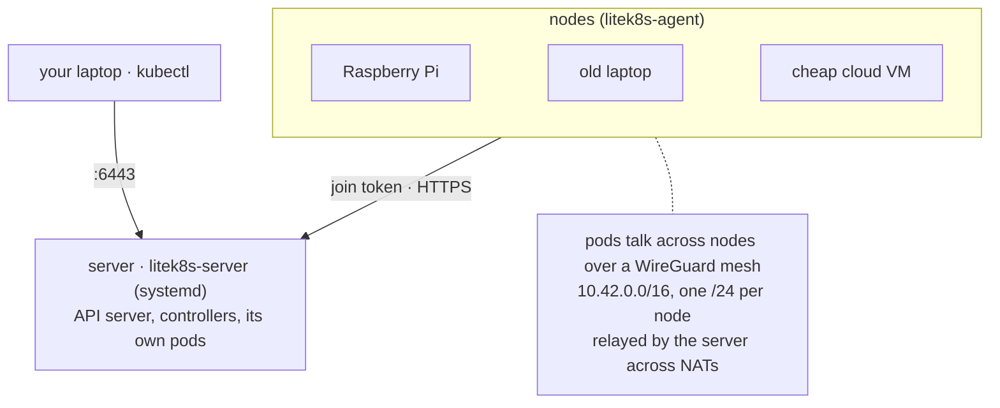
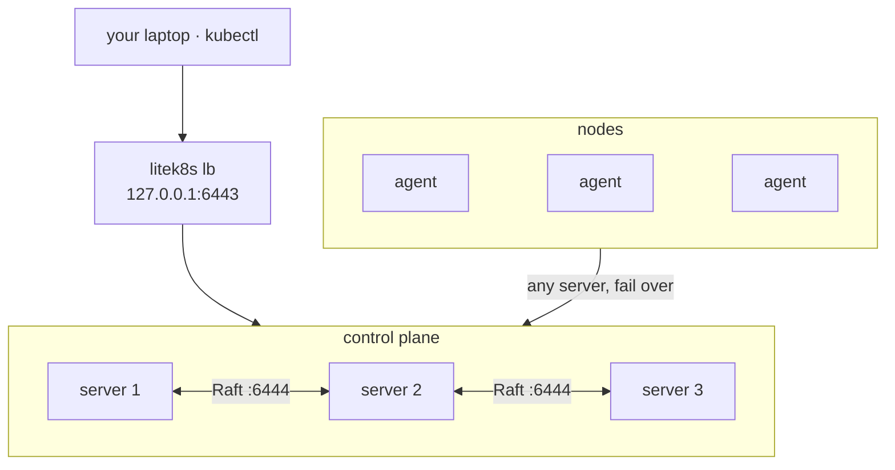

# Multi-node and HA

A server runs the whole control plane and its own pods; any Linux machine
(a Raspberry Pi, an old laptop, a cheap cloud VM) joins it as a node with
the token the server prints:



On Linux servers (systemd, root), one command per machine, like k3s's
installer:

```bash
# the server (pods run here too); prints the join command and the kubeconfig path
curl -fsSL https://raw.githubusercontent.com/jairoFernandez/litek8s/main/install.sh | sh -s -- server

# every other machine: the command the server printed
curl -fsSL https://raw.githubusercontent.com/jairoFernandez/litek8s/main/install.sh | sh -s -- \
  agent --join https://192.168.1.10:6443 --token K10<hash>::<secret>
```

This installs `/usr/local/bin/litek8s` (and `crun`/`iptables` from the
package manager when missing), checks the machine (cgroup v2, kernel
WireGuard, free ports) and runs `litek8s install server|agent`: a systemd
unit (`litek8s-server` / `litek8s-agent`, `Restart=always`) with the token in
`/etc/litek8s/*.env`, kubeconfig in `/etc/litek8s/kubeconfig.yaml`. Pods keep
running across `systemctl restart` and upgrades, and come back after a
reboot. Extra flags go to `litek8s apiserver` / `litek8s agent` (e.g.
`--node-ip`); re-running replaces them. `sudo litek8s uninstall [--purge]`
removes it all.

Or do it all from your laptop over SSH (your `~/.ssh/config`, keys and
agent; sudo on the machines), for one machine or a whole cluster declared
in a file ([clusters.md](clusters.md)):

```bash
litek8s install server --ssh pi@192.168.1.10      # adds the kubeconfig context
litek8s install agent --ssh me@old-laptop --join https://192.168.1.10:6443 --token K10<hash>::<secret>

cat > cluster.yaml <<'EOF'
apiVersion: litek8s.dev/v1
kind: Cluster
metadata: {name: home}
servers: [{ssh: pi@192.168.1.10}]               # 1, or 3 for HA
agents:
  - {ssh: me@old-laptop, labels: {disk: ssd}}
  - {ssh: ubuntu@ec2-host, nodeIp: 10.0.0.7}
EOF
litek8s cluster apply -f cluster.yaml             # again: no-op; agent removed + --prune: drained, uninstalled
litek8s cluster status -f cluster.yaml
```

Without systemd, run the same processes yourself:

```bash
litek8s apiserver --listen 0.0.0.0:6443 --data-dir /var/lib/litek8s/apiserver --node-ip 192.168.1.10
litek8s agent --join https://192.168.1.10:6443 --token K10<hash>::<secret> --node-ip 192.168.1.21
```

Every node gets a `/24` of `10.42.0.0/16`; Services and DNS work
cluster-wide. Nodes behind NAT need no VPN or port forwarding: two homes
reach each other directly when their routers allow it, and a pair with no
direct path goes through a relay, by default the server (a cloud VM with a
public address: `--node-external-ip`), with the data path in the kernel
([networking.md](networking.md)). A node that stops goes `NotReady` after 40 s and its pods are
rescheduled after their `tolerationSeconds`; laptops that sleep can join
with a longer `--node-grace-period`. Three servers make the control plane
highly available: `install.sh | sh -s -- server --cluster-init` on the first,
`... server --server https://<first>:6443 --token <token>` on two more
([ha.md](ha.md)). Any one server can die without losing writes;
`litek8s lb` gives kubectl one address in front of all three:


