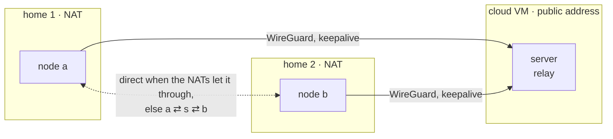

# Networking across nodes

Pods on different nodes talk over a kernel WireGuard mesh that litek8s sets
up itself: every node gets a `/24` of the cluster CIDR (`10.42.0.0/16` by
default) and one `litek8s-wg` interface, with every other node as a peer
whose allowed IPs are that node's pod CIDR. Pod addresses are never
masqueraded between nodes, so a pod sees the real address of the pod
talking to it, and Services DNAT straight to pods on other nodes.

Home machines are usually behind NAT, and a cheap cloud VM often has only a
private address of its own. litek8s handles that without a VPN in front:

- every peer has a 25 s keepalive, so a node that nobody can reach still
  works: it sends first, and WireGuard learns where its packets come from;
- endpoints seen from other nodes are offered as extra endpoints to try, so
  a home whose router forwards the WireGuard port, or maps it the same for
  every destination, is reached directly by the other nodes;
- a pair of nodes with no direct path at all goes through a **relay**, a
  node both of them reach.



## Relays

By default the servers relay (nodes with the
`node-role.kubernetes.io/control-plane` label, which `litek8s apiserver`'s
own node has). Label other nodes to relay as well, or to keep a server out:

```bash
kubectl label node my-cloud-vm litek8s.dev/relay=true
kubectl label node my-server litek8s.dev/relay=false
```

The data path stays in the kernel. When `a` and `b` have no direct path and
relay `s` reaches both:

- on `a`, the peer `s` gets `b`'s pod CIDR in its allowed IPs (and `b`'s own
  entry none), the same on `b` for `a`;
- `s` decrypts, its routing table sends the packet back into `litek8s-wg`,
  and WireGuard encrypts it towards the other node.

Each relay forwards only between WireGuard peers and only between pod
addresses (`LITEK8S-OVERLAY` filter chain: `-i litek8s-wg -o litek8s-wg -s
<cluster CIDR> -d <cluster CIDR> -j ACCEPT`, everything else from the
overlay back into it dropped; nodes that do not relay drop it all). The
peers are the cluster's nodes, which joined with the token, and WireGuard
accepts from each only its own pod addresses (or, through a relay, those of
the nodes behind it), so the relay is no open forwarder.

A pair's relay is the same seen from both sides (replies have to come back
the way the traffic went, or WireGuard drops them), chosen by rendezvous
hashing among the relays both sides reach: pairs spread over relays and stay
put when another relay is added.

## How a node finds out

Every agent watches its peers every 10 s, and sends each peer it routes
directly one small UDP datagram over WireGuard (to the peer's overlay
address, port 9): WireGuard answers a data packet with a keepalive within
10 s, so a working path carries traffic both ways (keepalives alone end up
one-sided: a received packet postpones the other side's).

| state | meaning |
|---|---|
| `direct` | routed directly: something arrived in the last 40 s over a session younger than 180 s; relayed: a handshake completed on the direct entry since the pair was relayed |
| `unreachable` | watched for 40 s without that |
| `unknown` | watched for less than 40 s (just started, or the route just changed); the last known state is kept |

It reports that to the server, which keeps it in the Node object (so every
server of an HA control plane computes the same routes from the same
objects) and computes the routes:

- a pair is relayed only when one side reports the other `unreachable`:
  pairs that work directly are never relayed;
- it goes back to direct when neither side does any more. The direct entry
  stays configured while relayed, without allowed IPs, so its keepalives
  keep probing the path;
- with no relay reached by both sides, the pair stays on its direct entry
  (`unreachable` in the routes).

While a peer is silent, its agent tries the next of its known endpoints
every 20 s: the one it announces, those other nodes see it at (where its
packets come from, behind its NAT), and, for a server, the address the
agent dials the API server at. A peer that gets through keeps the endpoint
WireGuard learned from its packets.

That reaches a node behind NAT whenever its router lets packets from other
nodes in: a port forward of UDP 51820, a full-cone mapping, the same LAN.
Between two NATs that do not, there is no hole punching to rely on: Linux
routers, for one, give a flow a new port when an unanswered packet from the
other side got there first, so neither side ever sees the port it sends to
answer. Such a pair is relayed, which costs the relay's bandwidth (on a
cloud VM, its egress); forward the port on one of the routers to make it
direct.

Changes go to the kernel peer by peer (no device-wide replace), so routing
one pair differently never resets the other sessions.

## Seeing it

Annotations on each Node:

| annotation | written by | content |
|---|---|---|
| `litek8s.dev/wireguard-public-key`, `litek8s.dev/wireguard-endpoint` | the agent, at join | its key and the endpoint it announces |
| `litek8s.dev/wireguard-peers` | the server, from the agent's reports | peer → `{"state": "direct", "endpoint": "203.0.113.7:51820"}` |
| `litek8s.dev/wireguard-routes` | the server | peer → `direct`, `via <relay>` or `unreachable` |

```bash
kubectl get node home-a -o jsonpath='{.metadata.annotations.litek8s\.dev/wireguard-routes}'
# {"cloud":"direct","home-b":"via cloud"}
litek8s tree
# ├─ nodes
# │  ├─ Node cloud   Ready, 3 pods, pods 10.42.0.0/24
# │  ├─ Node home-a  Ready, 2 pods, pods 10.42.1.0/24, overlay: home-b via cloud
```

Metrics, in the built-in observability ([observability.md](observability.md)),
per node:

| series | |
|---|---|
| `litek8s_overlay_peer_receive_bytes_total{peer}`, `..._transmit_bytes_total{peer}` | WireGuard's counters per peer |
| `litek8s_overlay_peer_last_handshake_age_seconds{peer}` | |
| `litek8s_overlay_peer_direct{peer}` | 1 direct, 0 unreachable |
| `litek8s_overlay_peer_relayed{peer,via}` | 1 when reached through `via` |
| `litek8s_overlay_relayed_bytes_total` | on relays: bytes forwarded for others |

```bash
litek8s query 'rate(litek8s_overlay_relayed_bytes_total[5m])'
litek8s query 'litek8s_overlay_peer_relayed == 1'
```

## A cloud VM with a public IP

A cloud VM's own address is private (the public one is 1:1 NAT). Give it
with `--node-external-ip`: it becomes the WireGuard endpoint the node
announces and the Node's `ExternalIP`.

```bash
litek8s install server --node-external-ip 203.0.113.7       # or: litek8s apiserver ... --node-external-ip
litek8s install agent --join https://203.0.113.7:6443 --token ... --node-external-ip 198.51.100.4
```

Without it, agents still try the address they dial the server at for the
server's node, and the server learns every agent's public endpoint from its
packets. Open UDP 51820 (`--wireguard-port`) in the VM's security group.

## LoadBalancer Services on servers and nodes

A LoadBalancer Service's status points at a node's `InternalIP`, and every
server and node listens on the Service's own ports (TCP), not only on its
NodePorts, like k3s's servicelb: an ingress controller's Service on 80 and
443 answers on every machine's 80 and 443, so a DNS record or the
`ExternalIP` of any node reaches it. Open those ports in the VM's security
group. A port the machine already uses (sshd's 22, the API's 6443) stays
with its owner and the node agent logs it; the NodePort still answers, and
the port is tried again whenever the Services change. Two Services on one
port: the first by namespace and name gets it. `--disable-loadbalancer-ports`
on `apiserver` and `agent` keeps only the NodePorts (k3s's
`--disable=servicelb`). Dev clusters publish both on the host's loopback
instead ([dev.md](dev.md)).

A server with LoadBalancer ports leaves 443 to them: its API server opens no
extra in-cluster port (`--in-cluster-port`, 443 otherwise), and pods reach it
through the `kubernetes` Service's ClusterIP, which forwards to its own port
(6443). `--in-cluster-port 443` brings the extra port back; a LoadBalancer
Service on 443 then answers on the other nodes only.

## Testing it

`bench/nat-e2e.sh` boots three VMs: a server with a public address and two
homes, each running its agent in a network namespace behind its own NAT
(both homes on `10.99.0.0/24`). It checks that the homes, which cannot
reach each other, go through the relay with pod-to-pod and Services working
both ways, relayed bytes in the metrics and `litek8s tree`; that a port
forward on one router makes them direct with nothing relayed; that cutting
that path moves them back to the relay and restoring it back to direct; and
then runs the compat corpus's M1 (multi-node) and M2 (relay) tiers across
the NATs.

Last run (2026-10-21, omarchy: qemu + KVM, Ubuntu 24.04 amd64 guests, 2 vCPU
each): the homes were relayed 44 s after their agents started, went direct
27 s after the port forward, had traffic back through the relay 45 s after
their path was cut and were direct again 141 s after it came back (the next
handshake on the direct entry); M1 5/5 and M2 2/2.

The route computation, observation, peer diffing and rules have unit tests
(`src/kube/agent/relay.rs`, `src/kube/agent/overlay.rs`).

## Limits

- Detection is not instant: a path that breaks is relayed after about a
  minute (40 s without answers, then the next report and push); a path
  that comes back is used again once a handshake gets through on it, which
  can take up to the next WireGuard rekey (2-3 minutes).
- One relay hop: a pair is relayed only through a node both sides reach
  directly.
- IPv4 only; one WireGuard port per node.
- All nodes of a cluster must run a litek8s that reports peers (0.2 and
  later): an older agent never uses a relay.
