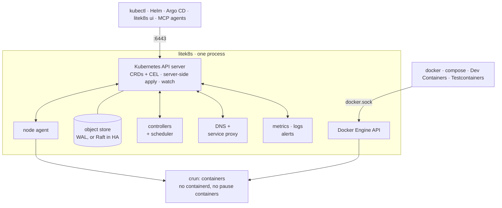

# litek8s: a lightweight Kubernetes in one binary

**A lightweight Kubernetes in one binary**, for local development, home
labs and the edge. It serves the real Kubernetes API, so `kubectl`, Helm
and Argo CD work unchanged, but the whole control plane, scheduler,
controllers, DNS, service proxy and node agent are one Rust process that
idles at 23 MiB on Linux (on macOS, plus the small VM it runs in).

```bash
litek8s dev up        # a local cluster: ~0.2 s on Linux, ~1.3 s on macOS
kubectl get nodes     # context litek8s-dev, merged into ~/.kube/config
litek8s ui            # terminal UI for the cluster, containers and images
```

> **Status: early preview (v0.x).** Built and tested by one person; expect
> rough edges. Servers authenticate clients and enforce RBAC
> ([Authentication and RBAC](auth.md)); see [Limitations](limitations.md).
> Feedback and issues are very welcome.

## What's in the binary

- **Dev clusters** (`litek8s dev`): kind/k3d/minikube without Docker. As
  many clusters as you like, each with as many nodes, in one rootless
  sandbox (Linux) or one small Virtualization.framework VM (macOS) that
  grows its memory on demand. NodePorts on `localhost`, your home directory mounted
  at the same path, `litek8s dev load` for local images. [dev.md](dev.md)
- **Docker Engine API** on `~/.litek8s/docker.sock`: `docker`,
  `docker compose`, `docker build`, Dev Containers and Testcontainers run
  on the dev cluster, next to (not instead of) Docker or OrbStack.
  [docker.md](docker.md)
- **Terminal UI** (`litek8s ui`): cluster state, a k9s-style Kubernetes
  view, containers by compose project with logs and shells, images,
  volumes, disk cleanup; keyboard-driven, works over SSH. [ui.md](ui.md)
- **Built-in observability**: an embedded time-series store with a
  Prometheus-compatible API (Grafana works), log search across every pod
  and node, alert rules to a webhook, ntfy or Telegram; `kubectl top`.
  [observability.md](observability.md)
- **Real servers and nodes**: `litek8s apiserver` on a box, more machines
  join with `litek8s agent --join ... --token ...` (k3s-style token that
  pins the CA), pods talk across nodes over a WireGuard mesh litek8s sets
  up itself. Pods run on crun directly: no containerd, no pause containers.
  [Multi-node](multi-node.md)
- **HA control plane**: 3 or 5 API servers share the store through Raft;
  no etcd. [ha.md](ha.md)
- **For LLM agents**: `litek8s mcp` is an MCP server (dev clusters, objects,
  pod diagnosis, logs, PromQL, alerts) with guardrails, and `litek8s skill`
  installs an agent skill: `claude mcp add litek8s -- litek8s mcp`.
  [agents.md](agents.md)
- **CRDs done properly**: OpenAPI schema validation, CEL rules type-checked
  and cost-estimated, ratcheting, server-side apply with managedFields.
  [crds.md](crds.md)

Use case: **one LLM across all your machines**. A model too big for any
one of them runs on several with llama.cpp's RPC backend (a DaemonSet of
workers, one OpenAI-compatible server):
[examples/llm-rpc](../examples/llm-rpc/README.md), [llm-cluster.md](llm-cluster.md).

## How it works

One process does what a Kubernetes distribution splits across etcd, the
API server, the controller manager, the scheduler, CoreDNS, kube-proxy,
the kubelet and containerd, plus a Docker-compatible API and a metrics,
logs and alerts stack:



## License

Apache-2.0, see [LICENSE](../LICENSE) and [NOTICE](../NOTICE). Third-party
components: [THIRD-PARTY.md](../THIRD-PARTY.md).
