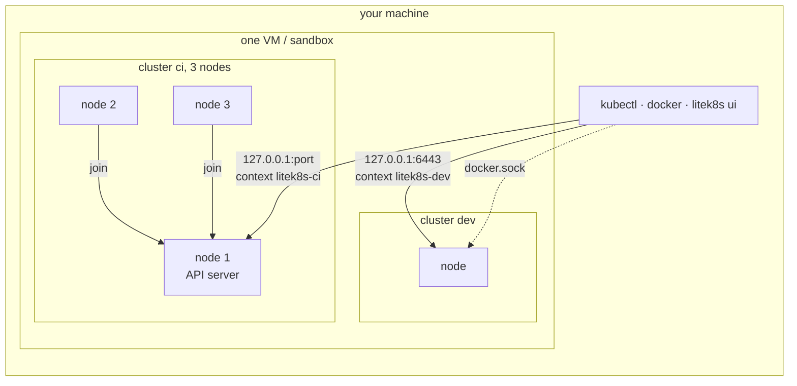

# Quickstart

```bash
litek8s dev up
kubectl create deployment web --image=nginx
kubectl expose deployment web --type=NodePort --port 80
curl localhost:$(kubectl get svc web -o jsonpath='{.spec.ports[0].nodePort}')

litek8s ui                                   # browse it all
export DOCKER_HOST=unix://$HOME/.litek8s/docker.sock
docker run --rm hello-world                  # the same cluster speaks the Docker API

litek8s dev up --name ci --nodes 3           # another cluster, three nodes
litek8s dev down                             # stop; objects and images are kept
litek8s dev delete                           # remove everything
```

Every cluster, and every node of a multi-node cluster, runs in one small
VM on macOS or one rootless sandbox on Linux, started with the first
cluster and stopped with the last. Each cluster gets its own API port,
kubectl context and Docker socket:


