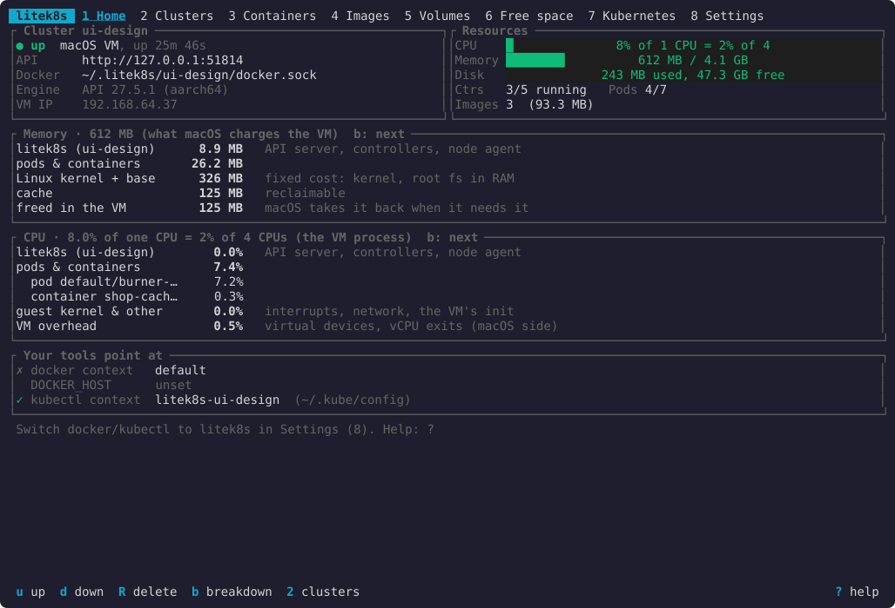
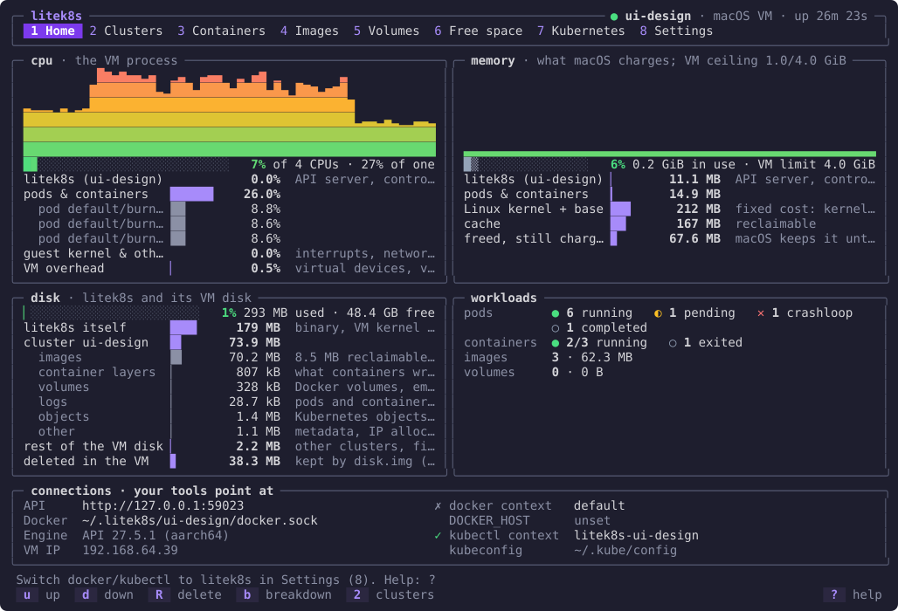
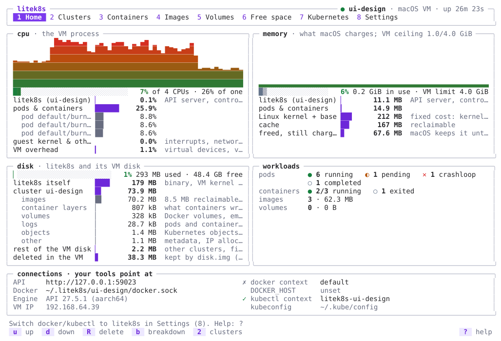
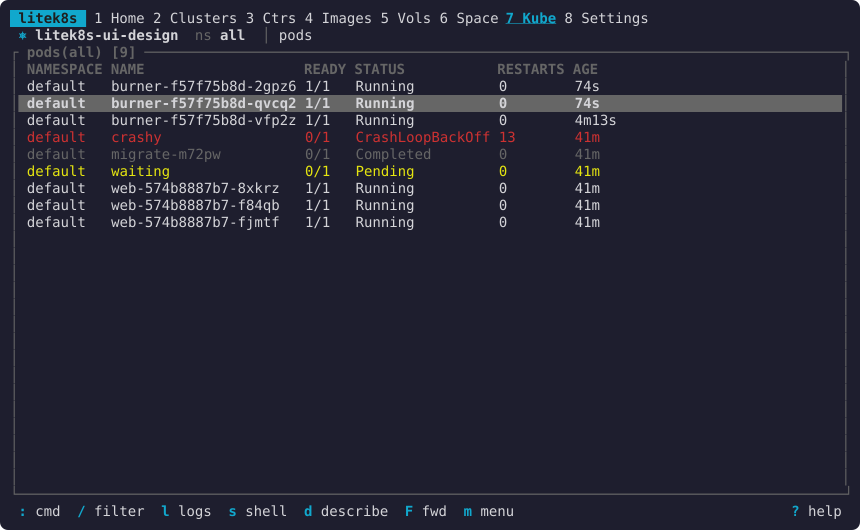
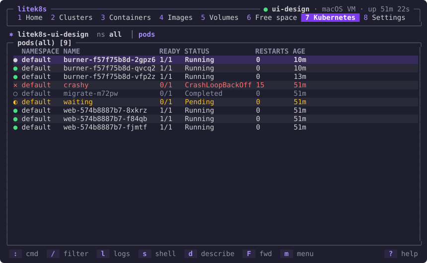

# `litek8s ui`: the dev environment in a terminal

`litek8s ui` is litek8s's answer to OrbStack's and Docker Desktop's windows:
see, configure and operate the local dev environment without remembering
commands. It is part of the same binary, keyboard-driven, fits an 80x24
terminal, and works the same locally and over SSH:

```bash
litek8s ui                  # this machine's dev clusters
litek8s ui --cluster ci     # starting on the local cluster `ci`
ssh -t box litek8s ui       # another machine's, in your terminal
```

Nine views, `1`-`9` (or `tab`) to switch, `?` for the keys of each:

| view | what it gives you |
|---|---|
| **1 Home** | the shown cluster's state (up, down, starting, stopping), mode, uptime; CPU, memory and disk of the VM or rootless sandbox; the Docker socket and API server; whether `docker` and `kubectl` point at it. `u` up, `d` down, `R` delete (asks first) |
| **2 Clusters** | the local clusters (state, API port, nodes, memory, age) and your kubeconfig's other contexts; `n` new (name, nodes), `u`/`d` up/down, `D` delete, `enter` shows it in every view (and offers to point `kubectl` and `docker` at it); see [Clusters](#clusters) |
| **3 Containers** | `docker ps -a`, grouped by compose project, with each project's memory against its budget, CPUs and OOM kills: `l` logs (follow), `s` a shell in the container, `u`/`x`/`r` start/stop/restart, `d` remove; on a project row they act on the whole project, `space` folds it |
| **4 Images** | sizes, age, which containers and pods use each; `d` remove |
| **5 Volumes** | sizes, which containers mount each, compose project; `d` remove |
| **6 Free space** | what can be reclaimed: stopped containers, dangling images, build cache, unused images, unused volumes; select with `space`, `p` frees it |
| **7 Kubernetes** | a cluster UI for any cluster or context (litek8s, k3s, EKS, GKE, …), k9s-style: `:` any resource (CRDs too), `/` filters and selectors, describe, YAML, edit with a server dry run and a diff, logs of pods and whole workloads, shells, port-forwards, xray trees; see [Kubernetes](#kubernetes-a-cluster-ui) |
| **8 Settings** | CPUs, memory, shared directories, API port, where published ports listen; switch the docker and kubectl contexts to litek8s and back; edit the settings file in `$EDITOR` |
| **9 Observe** | the cluster's alerts and its pods by CPU or memory with sparklines of the last 30 minutes, from the API server's built-in metrics; every log of a pod (gone containers included), a regex search of every pod's logs, acknowledge alerts; see [Observe](#observe) and [observability.md](observability.md) |

Everything that deletes or stops asks first, and says what goes: removing a
compose project lists its containers, deleting a cluster says it deletes
every object, image and volume and where they are, freeing space adds up
what it frees.

## Look

The UI is drawn in the spirit of [btop](https://github.com/aristocratos/btop):
rounded boxes with their titles set into the border, a header with the tabs
and the shown cluster's badge (state, mode, uptime), meters that go from
green through yellow to red with eighth-of-a-cell precision, history graphs
for CPU and memory, breakdowns as inline bars, and the same status glyphs
everywhere: `●` running, `◐` pending or starting, `✕` failed or crashing,
`○` completed or exited. Lists have bold headers, dim secondary text, rows
colored by state (plain while fine, yellow on the way, red when failing,
dim when done) and, when the terminal says what its background is, a
subtle zebra; the footer's keys are chips. The accent is litek8s's violet.

Before and after, on the Mac with the same cluster (`--cpus 4 --memory
4096`, a 3-replica deployment, a CPU-burning one, a crash-looping pod, a
pending one, a finished job, a compose project), in a dark terminal:





The same in a light terminal, and the Kubernetes view (dark, with the
zebra rows the terminal's reported background allows):







As text, 80x24 before:

```
 litek8s  1 Home 2 Clusters 3 Ctrs 4 Images 5 Vols 6 Space 7 Kube 8 Settings
┌ Cluster ui-design ───────────────────┐┌ Resources ───────────────────────────┐
│● up  macOS VM, up 48m 12s            ││CPU    ██  24% of 1 CPU = 6% of 4     │
│API      http://127.0.0.1:51814       ││Memory █████   644 MB / 4.1 GB        │
│Docker   …tek8s/ui-design/docker.sock ││Disk      252 MB used, 44.4 GB free   │
│Engine   API 27.5.1 (aarch64)         ││Ctrs   3/5 running   Pods 6/9         │
│VM IP    192.168.64.37                ││Images 3  (93.3 MB)                   │
└──────────────────────────────────────┘└──────────────────────────────────────┘
┌ Memory · 644 MB (what macOS charges the VM)  b: next ────────────────────────┐
│litek8s (ui-design)     11.3 MB   API server, controllers, node agent         │
│pods & containers       26.5 MB                                               │
│Linux kernel + base      331 MB   fixed cost: kernel, root fs in RAM          │
│cache                    130 MB   reclaimable                                 │
│freed in the VM          146 MB   macOS takes it back when it needs it        │
└──────────────────────────────────────────────────────────────────────────────┘
┌ Your tools point at ─────────────────────────────────────────────────────────┐
│✗ docker context   default                                                    │
│  DOCKER_HOST      unset                                                      │
│✓ kubectl context  litek8s-ui-design  (~/.kube/config)                        │
└──────────────────────────────────────────────────────────────────────────────┘
 Switch docker/kubectl to litek8s in Settings (8). Help: ?

 u up  d down  R delete  b breakdown  2 clusters                         ? help
```

and after: one column, the header a single line, the meters, pods and
containers by state, the breakdown `b` picks, where the tools point:

```
 litek8s  1 Home 2 Clust 3 Ctrs 4 Imgs 5 Vols 6 Space 7 Kube 8 Set 9 Obs
╭─ ● ui-design · macOS VM · up 26m 31s ──────────────────────────── resources ─╮
│ cpu    ██▍░░░░░░░░░░░░░░░░░░░░░░░░░░░   8% of 4 CPUs · 31% of one            │
│ memory ██▒▒░░░░░░░░░░░░░░░░░░░░░░░░░░   6% 0.2 GiB in use · VM limit 4.0 GiB │
│ disk   ▏░░░░░░░░░░░░░░░░░░░░░░░░░░░░░   1% 293 MB used · 48.4 GB free        │
│ pods   ● 6 running   ◐ 1 pending   ✕ 1 crashloop   ○ 1 completed             │
│ ctrs   ● 2/3 running   ○ 1 exited   images 3 · 62.3 MB                       │
╰──────────────────────────────────────────────────────────────────────────────╯
╭─ Memory · 474 MB (what macOS charges; VM ceiling 1.0/4.0 GiB)  b: next ──────╮
│ litek8s (ui-design)  ▎            11.0 MB  API server, controllers, node ag… │
│ pods & containers    ▍            14.9 MB                                    │
│ Linux kernel + base  ████▉         211 MB  fixed cost: kernel, page tables   │
│ cache                ███▉          167 MB  reclaimable                       │
│ freed, still charged █▋           70.3 MB  macOS keeps it until the VM rest… │
╰──────────────────────────────────────────────────────────────────────────────╯
╭─ connections · your tools point at ──────────────────────────────────────────╮
│ API     http://127.0.0.1:59023      ✗ docker context   default               │
│ Docker  …itek8s/ui-design/docker.sock DOCKER_HOST      unset                 │
│ Engine  API 27.5.1 (aarch64)        ✓ kubectl context  litek8s-ui-design     │
╰──────────────────────────────────────────────────────────────────────────────╯
 Switch docker/kubectl to litek8s in Settings (8). Help: ?

  u  up   d  down   R  delete   b  breakdown   2  clusters              ?  help
```

A wide and tall terminal (here 120x40) gets the boxed header, CPU and
memory side by side with their history (one column per sample, 2 s apart,
for as long as Home has been on screen), disk and the workloads under them:

```
╭─ litek8s ────────────────────────────────────────────────────────────────────── ● ui-design · macOS VM · up 26m 23s ─╮
│  1 Home  2 Clusters  3 Containers  4 Images  5 Volumes  6 Free space  7 Kubernetes  8 Settings  9 Observe            │
╰──────────────────────────────────────────────────────────────────────────────────────────────────────────────────────╯
╭─ cpu · the VM process ───────────────────────────────────╮╭─ memory · what macOS charges; VM ceiling 1.0/4.0 GiB ────╮
│           █▆▄▆▄▄▂▄  ▁▃  ▃▄▄  ▂ ▄▆ ▁        ▃             ││                                                          │
│          ▇████████▃▂███▄████▅████▄█▄▁█▇▆▃▅▆█             ││                                                          │
│ ▂▁▁▁ ▂ ▁▂███████████████████████████████████▇            ││                                                          │
│ █████████████████████████████████████████████▂▃▃▂▄▂▁▁▃▃▂ ││                                                          │
│ ████████████████████████████████████████████████████████ ││                                                          │
│ ████████████████████████████████████████████████████████ ││ ▃▃▃▃▃▃▃▃▃▃▃▃▃▃▃▃▃▃▃▃▃▃▃▃▃▃▃▃▃▃▃▃▃▃▃▃▃▃▃▃▃▃▃▃▃▃▃▃▃▃▃▃▃▃▃▃ │
│ █▉░░░░░░░░░░░░░░░░░░░░░░░░░░   7% of 4 CPUs · 27% of one ││ █▒░░░░░░░░░░░░░░░   6% 0.2 GiB in use · VM limit 4.0 GiB │
│ litek8s (ui-design)            0.0%  API server, contro… ││ litek8s (ui-design) ▏       11.1 MB  API server, contro… │
│ pods & containers   █████▉    26.0%                      ││ pods & containers   ▎       14.9 MB                      │
│   pod default/burn… ██         8.8%                      ││ Linux kernel + base ██▊      212 MB  fixed cost: kernel… │
│   pod default/burn… ██         8.6%                      ││ cache               ██▏      167 MB  reclaimable         │
│   pod default/burn… ██         8.6%                      ││ freed, still charg… ▉       67.6 MB  macOS keeps it unt… │
│ guest kernel & oth…            0.0%  interrupts, networ… ││                                                          │
│ VM overhead         ▏          0.5%  virtual devices, v… ││                                                          │
╰──────────────────────────────────────────────────────────╯╰──────────────────────────────────────────────────────────╯
╭─ disk · litek8s and its VM disk ─────────────────────────╮╭─ workloads ──────────────────────────────────────────────╮
│ ▏░░░░░░░░░░░░░░░░░░░░░░░   1% 293 MB used · 48.4 GB free ││ pods        ● 6 running   ◐ 1 pending   ✕ 1 crashloop    │
│ litek8s itself      ███▋     179 MB  binary, VM kernel … ││             ○ 1 completed                                │
│ cluster ui-design   █▌      73.9 MB                      ││ containers  ● 2/3 running   ○ 1 exited                   │
│   images            █▌      70.2 MB  8.5 MB reclaimable… ││ images      3 · 62.3 MB                                  │
│   container layers  ▏        807 kB  what containers wr… ││ volumes     0 · 0 B                                      │
│   volumes           ▏        328 kB  Docker volumes, em… ││                                                          │
│   logs              ▏       28.7 kB  pods and container… ││                                                          │
│   objects           ▏        1.4 MB  Kubernetes objects… ││                                                          │
│   other             ▏        1.1 MB  metadata, IP alloc… ││                                                          │
│ rest of the VM disk ▏        2.2 MB  other clusters, fi… ││                                                          │
│ deleted in the VM   ▊       38.3 MB  disk.img gives it … ││                                                          │
```

**Terminals.** Nothing needs a Nerd Font: only box-drawing and block
characters and a few common symbols. The UI adapts at start:

| | how it is decided | what changes |
|---|---|---|
| colors | `NO_COLOR` (non-empty): none; `COLORTERM=truecolor`/`24bit`: 24-bit; a `TERM` with `256` (and tmux, kitty, alacritty, ghostty, wezterm): 256; else 16 | 256: each color the nearest of the xterm palette; 16: the terminal's own named colors (made for its background), the selection in reverse video; none: bold, dim, underline and reverse only |
| background | `background:` in ui.yaml; else asked of the terminal once with OSC 11 (see below); else `COLORFGBG` | dark: lighter tones; light: darker ones and pale selections; unknown: mid tones that read on both, and a strong selection with its own text color; zebra rows only when the exact color is known |
| characters | `ascii: true` in ui.yaml, `LITEK8S_UI_ASCII=1`, or `TERM=linux`/`vt100`/`vt220` | box corners `+`, lines `-` `|`, blocks `#`, `●` `*`, `◐` `~`, `✕` `x`, `○` `o`, `…` `~`: a last pass over the finished frame, so the views draw one set of symbols |
| theme | `theme:` in ui.yaml | `default`; `high-contrast`: the terminal's bright colors, bold failures, no gray text or borders; `mono`: no colors at all |

```yaml
# ~/.litek8s/ui.yaml
theme: default        # high-contrast, mono
background: auto      # dark, light: skips asking the terminal
ascii: false          # true: ASCII for fonts without box and block characters
```

Settings (8) shows what was found (`Look: default, 24-bit color, dark
background`).

**Asking for the background** costs nothing that can fail: before the input
reader starts, the UI writes an OSC 11 query followed by a DA1 query and
reads the answers straight from the terminal. Terminals answer in order and
practically all answer DA1, so the wait ends at that answer: 0.1 ms in
tmux on the Mac, 11 ms over SSH to omarchy (one round trip); a terminal
that answers neither costs at most 150 ms once, and the UI starts with the
colors for either background. (The cursor-position query that once failed
the start in terminals that never answer is still not used.) It is skipped
when ui.yaml sets `background`, the theme is `mono`, or there are 16 colors
or fewer.

**Cost.** The history is a ring of 240 samples (two `f32` each), filled by
Home's 2 s samples only while Home is on screen, so it adds no timer and
no wake-up; hidden, nothing samples faster than before. Idle 60 s per view,
main against this look:

| | Home | Containers | Kubernetes |
|---|---|---|---|
| macOS, 120x40, CPU (`ps`) | 0.07 % → 0.08 % | 0.00 % → 0.02 % | 0.00 % → 0.00 % |
| Linux (omarchy), 80x24, CPU (`/proc`) | 0.12 % → 0.12 % | 0.02 % → 0.00 % | 0.00 % → 0.00 % |
| Linux, wake-ups (context switches) per minute | 124 → 130 | 19 → 8 | 13 → 13 |
| Linux, 120x40, Home | 0.12 % → 0.12 %, 137 → 119 wake-ups | | |

The first frame comes 1.0 ms → 1.2 ms after start (Mac, tmux). The
binary grows by 70 KiB stripped on macOS arm64 (35 460 136 → 35 532 200
bytes; 42 798 032 → 42 889 088 as built) and 12 KiB on Linux x86_64
(41 294 312 → 41 306 696), with no new dependency.

## Screens

Captured from real sessions on the macOS VM and, over SSH, the Linux
rootless sandbox; the test runs used scratch paths and a second API port,
shown here as a default install has them (`~/.litek8s`, `~/.kube/config`,
6443).

Home:

```
 litek8s  1 Home 2 Clust 3 Ctrs 4 Imgs 5 Vols 6 Space 7 Kube 8 Set 9 Obs
╭─ ● ui-design · macOS VM · up 26m 31s ──────────────────────────── resources ─╮
│ cpu    ██▍░░░░░░░░░░░░░░░░░░░░░░░░░░░   8% of 4 CPUs · 31% of one            │
│ memory ██▒▒░░░░░░░░░░░░░░░░░░░░░░░░░░   6% 0.2 GiB in use · VM limit 4.0 GiB │
│ disk   ▏░░░░░░░░░░░░░░░░░░░░░░░░░░░░░   1% 293 MB used · 48.4 GB free        │
│ pods   ● 6 running   ◐ 1 pending   ✕ 1 crashloop   ○ 1 completed             │
│ ctrs   ● 2/3 running   ○ 1 exited   images 3 · 62.3 MB                       │
╰──────────────────────────────────────────────────────────────────────────────╯
╭─ Memory · 474 MB (what macOS charges; VM ceiling 1.0/4.0 GiB)  b: next ──────╮
│ litek8s (ui-design)  ▎            11.0 MB  API server, controllers, node ag… │
│ pods & containers    ▍            14.9 MB                                    │
│ Linux kernel + base  ████▉         211 MB  fixed cost: kernel, page tables   │
│ cache                ███▉          167 MB  reclaimable                       │
│ freed, still charged █▋           70.3 MB  macOS keeps it until the VM rest… │
╰──────────────────────────────────────────────────────────────────────────────╯
╭─ connections · your tools point at ──────────────────────────────────────────╮
│ API     http://127.0.0.1:59023      ✗ docker context   default               │
│ Docker  …itek8s/ui-design/docker.sock DOCKER_HOST      unset                 │
│ Engine  API 27.5.1 (aarch64)        ✓ kubectl context  litek8s-ui-design     │
╰──────────────────────────────────────────────────────────────────────────────╯
 Switch docker/kubectl to litek8s in Settings (8). Help: ?

  u  up   d  down   R  delete   b  breakdown   2  clusters              ?  help
```

The memory meter is what the cluster's owners hold (litek8s, pods,
other clusters, the kernel and base) against the VM's `--memory`, the
sandbox's limit or, without one, the host's RAM, as stacked parts; cache
(`▒`, dim) and pages the guest freed but macOS still charges (`▒`, darker)
follow, and do not count as in use. Its percentage is colored by how short
the guest really is (its MemAvailable, plus what the VM's balloon would give
back), not by how full the meter looks: macOS's footprint of the VM also
keeps pages the guest freed long ago and can exceed the VM's size while the
guest has gigabytes available. It turns red, and says `short`, only when
less than a tenth or so is left.

Under the meters, Home explains its figures: what memory, CPU and disk are
made of, as inline bars, one box at a time on 80x24 (`b` shows the next; a
tall terminal shows all three). Memory, on the Mac (a fresh VM running the
compat corpus):

```
╭─ Memory · 589 MB (what macOS charges; VM ceiling 1.0/4.0 GiB)  b: next ──────╮
│ litek8s (dev)        ▎            11.9 MB  API server, controllers, node ag… │
│ pods & containers    ▏             635 kB                                    │
│ Linux kernel + base  ████          214 MB  fixed cost: kernel, page tables   │
│ cache                █████▌        296 MB  reclaimable                       │
│ freed, still charged █▎           65.8 MB  macOS keeps it until the VM rest… │
╰──────────────────────────────────────────────────────────────────────────────╯
```

| line | what it is | from |
|---|---|---|
| litek8s (cluster) | the shown cluster's own processes (API server, controllers, node agent, crun shims) on all its nodes | its cells' cgroups: usage less file pages, less the pods' |
| pods & containers | its pods, Docker containers and image builds | the `pod*`, `docker/*`, `build/*` cgroups under each node |
| other clusters | the same two for every other running cluster, together | their cells |
| Linux kernel + base (macOS) | what the VM costs before anything runs: memory the kernel sets aside at boot (its image and the page structures, ~3.5 % of the VM's size), its unreclaimable slab, stacks and page tables, and tmpfs (an older guest's initramfs, the root filesystem held in RAM); also the VM's own init, cell manager and DHCP client | the VM's size less `MemTotal` and the balloon, `/proc/meminfo` |
| sandbox (Linux) | the supervisor, pasta and the cell manager | the sandbox's cgroup less the clusters' |
| cache | file pages: images, logs, the binary; the kernel drops them under pressure | `/proc/meminfo` (VM) or the sandbox's `file` pages |
| freed, still charged (macOS) | pages the guest used once and has freed (or handed to the balloon since): Virtualization.framework keeps charging them to the VM until it stops, however much macOS needs memory (it compresses or swaps them like any other); the guest reuses them before it touches more. Restarting the VM (`dev down`, `dev up`) hands them back | the footprint less what the guest uses |

The title also says how much of its memory the guest may use now when that
is less than all of it: the VM's ceiling, which grows on demand and shrinks
when the guest is idle ([dev.md](dev.md#memory-on-macos)); what is above it
was never touched, and macOS charges nothing for it.

The headline figure is what macOS charges the VM process (its physical
footprint, what Activity Monitor shows) or, on Linux, the sandbox's cgroup.
The guest's numbers come from its cgroups and `/proc/meminfo` through the
VM's control channel; a remote litek8s (`--context`) answers
`GET /litek8s/v1/memory` on its API server with its node's split (litek8s,
pods and containers, cache) and its meminfo, which Home shows instead. It
is sampled with the rest of Home: every 2 s while Home is on screen, not
otherwise.

CPU, between the last two samples (2 s), in % of one CPU, on the Mac with
three busy pods:

```
╭─ CPU · 19.7% of one CPU = 5% of 4 CPUs (the VM process)  b: next ────────────╮
│ litek8s (ui-design)      ▏              0.1%  API server, controllers, node… │
│ pods & containers        █████████▋    18.9%                                 │
│   pod default/burner-f5… ███▎           6.3%                                 │
│   pod default/burner-f5… ███▏           6.2%                                 │
│   pod default/burner-f5… ███▏           6.1%                                 │
│ guest kernel & other     ▎              0.4%  interrupts, network, the VM's… │
│ VM overhead              ▏              0.3%  virtual devices, vCPU exits (… │
╰──────────────────────────────────────────────────────────────────────────────╯
```

| line | what it is | from |
|---|---|---|
| litek8s (cluster) | the shown cluster's own processes on all its nodes | its cells' `cpu.stat` less its pods' |
| pods & containers, and the top 3 | every pod, Docker container and build of the cluster, the busiest by name | the `pod*`, `docker/*`, `build/*` cgroups (`usage_usec`) |
| other clusters | the rest of the clusters together | their cells |
| guest kernel & other (macOS) | busy time the guest does not account to a cluster: interrupts, the network stack, the VM's init | the guest's `/proc/stat` less the clusters |
| VM overhead (macOS) | what the VM process ran beyond the guest's busy time: virtual devices, vCPU exits | the VM process's CPU time (macOS) less the guest's `/proc/stat` |
| sandbox (Linux) | the supervisor, pasta and the cell manager | the sandbox's cgroup less the clusters' |

The title's figure is the VM process's CPU time as macOS counts it, or the
sandbox's cgroup; the cpu meter says the same as `5% of 4 CPUs · 20% of
one`.

Disk, on the Mac with the workloads above (the walk is at most a minute
old):

```
╭─ Disk · 311 MB (litek8s and its VM disk)  b: next ───────────────────────────╮
│ litek8s itself      ██████▍       178 MB  binary, VM kernel and root fs      │
│ cluster ui-design   ███▋          103 MB                                     │
│   images            ███▌         99.9 MB  layers shared by pods, Docker, bu… │
│   container layers  ▏             688 kB  what containers wrote              │
│   volumes           ▏             229 kB  Docker volumes, emptyDirs, PVs     │
│   logs              ▏            36.9 kB  pods and containers, 10 MiB each   │
│   objects           ▏             1.7 MB  Kubernetes objects, keys           │
│   other             ▏             872 kB  metadata, IP allocations           │
│ rest of the VM disk ▏             2.1 MB  other clusters, filesystem         │
│ deleted in the VM   █            26.6 MB  disk.img gives it back within a m… │
╰──────────────────────────────────────────────────────────────────────────────╯
```

| line | what it is |
|---|---|
| litek8s itself | the `litek8s` binary; on macOS also the VM's kernel, root image and initrd and the signed copy of the binary the VM runs from |
| images | the unpacked layers of every image and of the build cache: one content-addressed store per node, shared by pods, Docker and builds, each layer once |
| container layers | what pod containers and Docker containers wrote (their overlay upper directories) |
| volumes | Docker volumes (named and anonymous), pods' emptyDirs, local PVs, ConfigMap and Secret files |
| logs | pod and container logs (10 MiB and one rotated file each) |
| builds | builds in progress and `RUN --mount=type=cache` directories |
| objects | Kubernetes objects (the write-ahead log, compacted) and the cluster's keys |
| other nodes | a multi-node cluster's workers (each with its own image store) |
| other | metadata, IP allocations, staging |
| rest of the VM disk (macOS) | the other clusters and the filesystem's own blocks |
| deleted in the VM (macOS) | blocks the guest freed that `disk.img` still holds: the guest trims its disk once it has been quiet for 30 s (at most once a minute), and Virtualization.framework punches the trimmed blocks out of the sparse image, so this goes back to about zero shortly after a prune |

Where images, container layers and volumes have something to reclaim, the
note says how much and points at the Free space view (6), which frees it:
those amounts come from the Docker API's `/system/df` (unused images and
build cache, stopped containers, unused volumes). The categories come from
`GET /litek8s/v1/disk` on the cluster's API server: one walk of the node's
data directory that counts allocated blocks and hard links once, classifies
each file by where it is (so the parts add up to the whole), and runs at
most once a minute, in the background (Home asks every 30 s while it is on
screen). `/system/df`'s `LayersSize` now counts each layer once and images
report their `SharedSize`, as Docker does.

Against a remote litek8s (`--context`), the three boxes show its API server's
node: `GET /litek8s/v1/memory`, `/litek8s/v1/cpu` (cumulative counters, two
samples make the percentages) and `/litek8s/v1/disk`, and its machine's
`/proc/stat` for the rest of its CPU.

After `u` on a stopped cluster, the output of `litek8s dev up` shows under
it (here on Linux, over SSH):

```
╭─ output ─────────────────────────────────────────────────────────────────────╮
│$ litek8s dev up                                                              │
│litek8s-dev ready in 0.10s (rootless, http://127.0.0.1:6443, kubectl context  │
╰──────────────────────────────────────────────────────────────────────────────╯
```

On Linux the mode is `rootless sandbox`, and the meters are against the
machine (here omarchy's 16 CPUs and 33.6 GB, over SSH) or, with a CPU or
memory limit set in Settings, against the limit:

```
 litek8s  1 Home 2 Clust 3 Ctrs 4 Imgs 5 Vols 6 Space 7 Kube 8 Set 9 Obs  ● dev
╭─ ● dev · rootless sandbox · up 7h 51m ─────────────────────────── resources ─╮
│ cpu    ░░░░░░░░░░░░░░░░░░░░░░░░░░░░░   0% of 16 CPUs · 0% of one             │
│ memory ▍░░░░░░░░░░░░░░░░░░░░░░░░░░░░   0% 0.1 GiB in use · host RAM 31.3 GiB │
│ disk   ░░░░░░░░░░░░░░░░░░░░░░░░░░░░░   0% 137 MB used · 1.5 TB free          │
│ pods   ● 0 running                                                           │
│ ctrs   ● 1/1 running   images 3 · 122 MB                                     │
╰──────────────────────────────────────────────────────────────────────────────╯
```

Containers, with a compose project (a worker that exited with 3) and a
confirmation:

```
 litek8s 1 Home 2 Clust  3 Ctrs 4 Imgs 5 Vols 6 Space 7 Kube 8 Set 9 Obs
╭─ Containers ─────────────────────────────────────────────────── 3/5 running ─╮
│ NAME                    STATE       IMAGE                   PORTS            │
│ api                     ● running   nginx:1.27-alpine       18080->80/tcp    │
│ scratch                 ○ exited    busybox:1.36                             │
│▌▾ shop                  ◐ 2/3 up    compose project                          │
│   cache                 ● running   redis:7-alpine          6379/tcp         │
│   web                   ● running   nginx:1.27-alpine       80/tcp           │
│   worker       ╭─ ⚠ Stop project shop? ────────────────────╮                 │
│                │ shop-cache-1 (redis:7-alpine, running)    │                 │
│                │ shop-web-1 (nginx:1.27-alpine, running)   │                 │
│                │ shop-worker-1 (busybox:1.36, exited)      │                 │
│                │                                           │                 │
│                │  y  yes    n/esc  no                      │                 │
│                ╰───────────────────────────────────────────╯                 │
╰──────────────────────────────────────────────────────────────────────────────╯
 l logs  s shell  u start  x stop  r restart  d remove  / filter        ?  help
```

### Containers and budgets

On litek8s a compose project can have a resource budget
([docker.md](docker.md#resource-budgets-for-compose-projects)). Its row
then shows the project's memory against the budget (the meter Home uses),
the CPUs it uses out of its budget, and how many processes the OOM killer
took; a container the OOM killer stopped says `OOMKilled` instead of
`exited`, and the kill shows in the status line as it happens
(`shop-worker-1 was OOM-killed: compose project shop hit its 256Mi budget`):

```
╭─ Containers ─────────────────────────────────────────────────── 2/4 running ─╮
│ NAME                    STATE       IMAGE                   PORTS            │
│▌scratch                 ○ exited    nginx:1.27                               │
│ ▾ shop                  ◐ 2/3 up    ████▌░  75% 192Mi/256Mi cpu 0.5/2 ✗ 1 OOM│
│   web                   ● running   nginx:1.27              8080->80/tcp     │
│   db                    ● running   nginx:1.27              8080->80/tcp     │
│   worker                ✕ OOMKilled nginx:1.27                               │
╰──────────────────────────────────────────────────────────────────────────────╯
```

A project without a budget shows its memory (`mem 115Mi · no budget`).
Use is sampled every 2 s while the view is on screen (one request to
`/litek8s/v1/docker/projects`) and not at all otherwise; other Docker
engines have no budgets and are not asked again.

`l` follows a container's (or pod's) log; `↑`/`PgUp` scroll back and stop
following, `G` or `f` follow again, `w` wraps long lines. Escape sequences
are stripped, so colored logs cannot paint over the UI:

```
╭─ logs: api ─────────────────────────────────────────────────────── ● follow ─╮
│ 2026/10/20 05:02:04 [notice] 1#1: OS: Linux 6.12.113-0-virt                  │
│ 2026/10/20 05:02:04 [notice] 1#1: getrlimit(RLIMIT_NOFILE): 4096:4096        │
│ 2026/10/20 05:02:04 [notice] 1#1: start worker processes                     │
│ 2026/10/20 05:02:04 [notice] 1#1: start worker process 25                    │
│ 2026/10/20 05:02:04 [notice] 1#1: start worker process 26                    │
│ 2026/10/20 05:02:04 [notice] 1#1: start worker process 27                    │
│ 2026/10/20 05:02:04 [notice] 1#1: start worker process 28                    │
╰──────────────────────────────────────────────────────────────────────────────╯
  esc  back   f  follow   w  wrap   ↑↓  scroll   g/G  top/end           ?  help
```

`s` suspends the UI and opens a shell in the container (bash if it has one,
else sh) with your terminal's size, following resizes; exit the shell to
come back. It is `docker exec -it` over the Docker API, so it needs no
`docker` CLI.

Images:

```
 litek8s 1 Home 2 Clust 3 Ctrs  4 Imgs 5 Vols 6 Space 7 Kube 8 Set 9 Obs
╭─ Images ─────────────────────────────────────────────────────── 3 · 93.3 MB ─╮
│ IMAGE                           SIZE     AGE   USED BY                       │
│▌busybox:1.36                      4.1 MB 1250d scratch +7                    │
│ nginx:1.27-alpine                49.7 MB 551d  api +4                        │
│ redis:7-alpine                   39.5 MB 32d   shop-cache-1                  │
╰──────────────────────────────────────────────────────────────────────────────╯
  d  remove   /  filter   6  free space                                 ?  help
```

Free space, and what `p` asks before it frees anything:

```
 litek8s 1 Home 2 Clust 3 Ctrs 4 Imgs 5 Vols  6 Space 7 Kube 8 Set 9 Obs
╭─ Reclaimable space ───────────────────────────────────────────── 0 B in all ─╮
│     WHAT                                        ITEMS  SIZE                  │
│▌[✓] Stopped containers                               2       0 B             │
│ [✓] Dangling images (untagged, unused)               0       0 B             │
│ [✓] Build cache                                      0       0 B             │
│ [ ] Unused images (no container or pod)              0       0 B             │
│ [ ] Unused volumes (data is lost)                    1       0 B             │
╰────────────────╭─ ⚠ Free space? ───────────────────────────╮─────────────────╯
 Selected  0 B   │ Stopped containers: 2 (0 B)               │
                 │ About 0 B freed. This cannot be undone.   │
 litek8s data  31│                                           │s.litek8s/dev
 disk free    47.│  y  yes    n/esc  no                      │
                 ╰───────────────────────────────────────────╯
 Docker and Kubernetes share one image store: images no container or pod
 uses are unused (pods pull them again when needed). Volumes are never
 selected by default: they hold data.
  space  select   p  free selected                                      ?  help
```


Kubernetes, all namespaces (`0`); `ctrl-z` would keep the crashing and
pending ones:

```
 litek8s 1 Home 2 Clust 3 Ctrs 4 Imgs 5 Vols 6 Space  7 Kube 8 Set 9 Obs
 ⎈ litek8s-ui-design  ns all  │ pods
╭─ pods(all) [9] ──────────────────────────────────────────────────────────────╮
│   NAMESPACE NAME                   READY STATUS           RESTARTS AGE       │
│ ● default   burner-f57f75b8d-2gpz6 1/1   Running          0        8m40s     │
│ ● default   burner-f57f75b8d-qvcq2 1/1   Running          0        8m40s     │
│ ● default   burner-f57f75b8d-vfp2z 1/1   Running          0        11m       │
│ ✕ default   crashy                 0/1   CrashLoopBackOff 14       49m       │
│ ○ default   migrate-m72pw          0/1   Completed        0        49m       │
│ ◐ default   waiting                0/1   Pending          0        49m       │
│ ● default   web-574b8887b7-8xkrz   1/1   Running          0        49m       │
│ ● default   web-574b8887b7-f84qb   1/1   Running          0        49m       │
│ ● default   web-574b8887b7-fjmtf   1/1   Running          0        49m       │
╰──────────────────────────────────────────────────────────────────────────────╯
 : cmd  / filter  l logs  s shell  d describe  F fwd  m menu            ?  help
```

More of it in [Kubernetes](#kubernetes-a-cluster-ui).

Settings of a cluster started with `--cpus 4` while the file names none (so
its default, 7, would need a restart), and what the UI found about the
terminal:

```
╭─ Settings ───────────────────────────────────────────────────────────────────╮
│ SETTING              VALUE                                                   │
│▌VM CPUs              7 (default)                                             │
│ VM memory (MiB)      4096 (default)                                          │
│ Shared directories   $HOME (default)                                         │
│ API port (dev)       6443 (default)                                          │
│ Published ports on   localhost only                                          │
│ docker context       default  (enter: use litek8s)                           │
│ kubectl context      litek8s-ui-design ✓  (enter: switch back)               │
│ Config file          ~/.litek8s/config.yaml  (enter: $EDITOR)                 │
╰──────────────────────────────────────────────────────────────────────────────╯
 ⟳ Restart needed for CPUs: Home (1), d then u.
 CPUs, memory and shares size the macOS VM.
 Settings apply on the next `litek8s dev up` (its flags win).
 Look: default, 24-bit color, background unknown (ui.yaml)
  enter  edit   del  default   space  toggle                            ?  help
```

## Clusters

`litek8s dev` runs as many clusters as you like in one VM or sandbox
([dev.md](dev.md#several-clusters)); view 2 lists them, with the VM's or
sandbox's size and what it uses, and the other contexts of your kubeconfig
(a home cluster, a cloud one) read-only. On the Mac, with a 3-node cluster
and a stopped one:

```
 litek8s 1 Home  2 Clust 3 Ctrs 4 Imgs 5 Vols 6 Space 7 Kube 8 Set 9 Obs  ● dev
╭─ Local clusters ──────────────── shared VM: 4 CPUs, 4.3 GB max, 412 MB used ─╮
│ NAME           STATE       API              NODES MEMORY    AGE  CONTEXT     │
│▌› dev          ● up        127.0.0.1:6443   1     27.2 MB   8m   litek8s-dev │
│   ci           ● up        127.0.0.1:61325  3     5.6 MB    2m   litek8s-ci  │
│   old          ○ down      -                1     -         3d   litek8s-old │
╰──────────────────────────────────────────────────────────────────────────────╯
╭─ Other kubeconfig contexts ───────────── read-only · enter: Kubernetes view ─╮
│   home                          https://192.168.1.10:6443                    │
╰──────────────────────────────────────────────────────────────────────────────╯
 All clusters share one VM (its CPUs and memory: Settings).

  n  new   u  up   d  down   D  delete   enter  use                     ?  help
```

`›` marks the cluster the other views show; `●` up, `◐` starting or
stopping, `○` down. MEMORY is the cluster's own:
its nodes' processes and pods, counted the way `docker stats` counts a
container (the binary and the VM's kernel are shared and not in it); the
title's figure is the whole VM (or sandbox). NODES shows `2/3` while a node
is not Ready.

`n` asks for a name and a node count, and says what the cluster shares:

```
      ╭─ New cluster ────────────────────────────────────────────────────╮
      │ › Name   ci2█                                                    │
      │   Nodes  1                                                       │
      │                                                                  │
      │ Runs in the shared VM: 4 CPUs, 4096 MiB for all clusters.        │
      │ Context litek8s-ci2, socket ~/.litek8s/ci2/docker.sock             │
      │ Nodes after the first are workers joined like real nodes.        │
      │                                                                  │
      │   tab  next field   enter  create   esc  cancel                  │
      ╰──────────────────────────────────────────────────────────────────╯
```

and runs `litek8s dev up --name ci2 --nodes 3 --no-switch` (kubectl's
current context stays as it is), its output under the list. `D` says what
goes before it goes (here on Linux):

```
 ╭─ Delete cluster t1? ───────────────────────────────────────────────────────╮
 │Stops it and DELETES all of its data:                                       │
 │Kubernetes objects, pods, Docker containers, images, volumes                │
 │and the build cache, in ~/.local/share/litek8s/dev/clusters/t1/data.        │
 │The kubectl context litek8s-t1 is removed. This cannot be undone.           │
 │                                                                            │
 │ y  yes    n/esc  no                                                        │
 ╰────────────────────────────────────────────────────────────────────────────╯
```

`enter` on a local cluster shows it everywhere (Home, Containers, Images,
Volumes, Free space and Kubernetes follow its Docker socket and API) and
then asks whether `kubectl` and `docker` should point at it too
(`current-context` and the docker context `litek8s-<name>`); the UI
remembers it for next time. `enter` on another context shows that context
in the Kubernetes view only (nothing to start or stop there); `enter` on a
local cluster comes back.

While a cluster or its engine is down, Home says so instead of counting
nothing: `pods –`, `ctrs – (engine not running)`, not `0/0` and `0 (0 B)`.

## Observe

View 9, on the cluster's built-in metrics, logs and alerts
([observability.md](observability.md)):

```
 litek8s 1 Home 2 Clust 3 Ctrs 4 Imgs 5 Vols 6 Space 7 Kube 8 Set  9 Obs  ● dev
╭─ Alerts ────────────────────────────────────────────── 3 firing · 0 pending ─╮
│ ✕ firing  NodeFilesystemAlmostFull 7m     Node obs-smoke has 4.853% disk lef…│
│ ◐ firing  KubePodCrashLooping      6m     default/crasher-778d767f48-4zrkx (…│
│ ◐ firing  KubePodRestartLoop       5m     default/crasher-778d767f48-4zrkx (…│
╰──────────────────────────────────────────────────────────────────────────────╯
╭─ Pods by CPU ────────────────────────────────────────────────── last 30 min ─╮
│ NAMESPACE    POD          CPU                      MEMORY                    │
│▌shop         db-0           800m ▅▅▅ ▅▆▆▆▆▆▇▇▇▇███  60.0 MB ▂▂▂ ▃▃▃▃▃▃▃▃▃▃▃▄▄│
│ default      web-7d9-abc    100m ▁▁▁ ▂▂▂▂▂▂▂▂▂▂▂▂▂   160 MB ▅▅▅ ▅▆▆▆▆▆▇▇▇▇███│
│                                                                              │
╰──────────────────────────────────────────────────────────────────────────────╯
  l  logs   L  search logs   s  sort   a/A  ack   n  namespace          ?  help
```

- **Alerts** first: `✕` firing and critical, `◐` firing, `○` pending or
  acknowledged (dim); `a` acknowledges the selected pod's alerts, `A` all of them (each
  silenced until it resolves; asks first).
- **Pods** by CPU (cores, `m` = millicores) or memory (working set; `s`
  switches), top consumers first, with a sparkline per pod over the last 30
  minutes (one cell per ~2 minutes; a gap where there was no sample).
  `n` cycles namespaces, `/` filters.
- **Logs**: `l` opens every log of the selected pod over the last hour,
  following, including containers that restarted or are gone; `L` asks
  for a regex and searches every pod's logs (of the namespace shown) over
  the last hour, then follows.

It reads `/prometheus/api/v1/query_range` (two queries) and
`/litek8s/v1/alerts` every 10 s while the view is on screen, and nothing
otherwise; against an API server with `--no-observability` it says so.

## Settings: `~/.litek8s/config.yaml`

The Settings view edits a small file that `litek8s dev up` reads (its flags
win over it); `$LITEK8S_CONFIG` moves it. Every change is validated before it
is written: CPUs between 1 and the machine's, memory between 1024 MiB and
its RAM, a port of 1024 or above, shared directories that exist, are
absolute, do not overlap and are not already shared.

```yaml
cpus: 4              # macOS: the VM's CPUs (default: half the Mac's, at most 8)
                     # Linux: a CPU limit on everything the dev cluster runs (default: none)
memory: 4096         # MiB; macOS: the VM's ceiling (default 4096); Linux: a limit (default: none)
shares:              # macOS: directories shared with the VM at the same path (default: $HOME;
  - /Users/me        #   /tmp and /var/folders are always shared)
  - /Volumes/src
port: 6443           # the API server's port on localhost
publish: localhost   # where published container ports and NodePorts listen:
                     #   localhost (default) or all (other machines on the network too)
docker:              # Docker API: compose project budgets, container defaults
  projects: {shop: {memory: 2Gi, cpus: 2}}
  default_project: {memory: 4Gi}
```

The file is read when the cluster starts. The cluster records what it
started with, so the Settings view (and nothing else) tells you which
changes still need `d` and `u` on Home. "Config file" opens it in
`$VISUAL`/`$EDITOR` (`vi` otherwise) and checks it when the editor exits;
a changed `docker:` section goes to the running cluster's Docker API at
once (no restart, see [docker.md](docker.md#resource-budgets-for-compose-projects)).

## Contexts: pointing your tools at litek8s

Home shows, and Settings switches:

- **docker context.** "use litek8s" creates (or updates) a `litek8s`
  context for `unix://~/.litek8s/docker.sock` (for another cluster,
  `litek8s-<name>` for `~/.litek8s/<name>/docker.sock`) and makes it current, with
  `docker context` when the CLI is installed and by writing the CLI's
  context store (`$DOCKER_CONFIG/contexts`, `config.json`) when it is not.
  "switch back" returns to the context that was current before
  (`default` if none was recorded). `DOCKER_HOST`, when set in your shell,
  wins over any context; Home says so.
- **kubectl context.** "use litek8s-dev" makes the shown cluster's context
  (`litek8s-<name>`) current (adding it if the cluster runs); "switch back" restores the
  previous current context. Nothing else in the kubeconfig changes.

What was current before is kept in `~/.litek8s/ui-state.json`.

## Kubernetes: a cluster UI

View 7 is a cluster UI in the spirit of [k9s](https://k9scli.io), for any
cluster: the local dev clusters, and every context of your kubeconfig
(k3s, kind, EKS, GKE, AKS, …). Its keys are k9s's where k9s has one, so
k9s habits work; it is lighter (see [the numbers](#kubernetes-performance))
and comes with litek8s.

```bash
litek8s ui --context prod -n payments   # start on a context and namespace
```

or `:ctx` inside to pick one. Credentials are what kubectl reads:
`$KUBECONFIG` (all its files, merged as kubectl merges them), tokens, token
files, client certificates, basic auth, and **exec plugins**
(`gke-gcloud-auth-plugin`, `aws eks get-token`, `kubelogin`, …), run when a
token is needed and again when it expires or the server refuses it. Every
request goes to the context the UI shows; `:kubectl` passes it as
`--context`, so the kubeconfig's current context is never used by accident.

### Command mode (`:`)

| command | what it shows or does |
|---|---|
| `:pods`, `:po`, `:deploy`, `:dp`, `:svc`, `:ing`, `:no`, `:ns`, `:ev`, `:crd`, `:cm`, `:sec`, `:pvc`, … | that resource type: any type the cluster serves, custom resources and aggregated APIs included, by plural, singular, short name, kind or `plural.group` (`:certificates.cert-manager.io`, `:cert`) |
| `:pods kube-system`, `:pods -n kube-system`, `:deploy -A` | in a namespace, or all of them |
| `:pods -l app=web,tier!=db`, `:pods -f status.phase=Running`, `:pods /nginx` | with a label selector, a field selector (sent to the server), a filter |
| `:ctx` / `:ctx prod` | pick a context / switch to one (the views reconnect) |
| `:ns` / `:ns web` | the namespaces / switch the namespace |
| `:tree`, `:tree shop`, `:tree -A --all` | the cluster as [`litek8s tree`](#tree) draws it, live (below); `--all` adds old ReplicaSets |
| `:xray deploy [ns]` | owner trees: deploy → ReplicaSets → pods → containers (also `sts`, `ds`, `rs`, `job`, `cronjob` → jobs → pods, `svc` → its pods, `node` → its pods) |
| `:kubectl get events -A`, `:!top pods`, `!` | kubectl on the UI's context and namespace; its output in a pager (`exec -it`, `edit`, `attach` get the terminal) |
| `:pf` | the running port-forwards |
| `:aliases` | every resource type, to pick one |
| `:help`, `:q` | the keys; quit |

`tab` (or `→`) completes resource names, commands, namespaces after `-n` or
`:ns`, contexts after `:ctx`; the first candidate shows greyed after the
cursor. `↑`/`↓` walk the history (kept in `~/.litek8s/ui-history`).
Aliases of your own come from [`ui.yaml`](#uiyaml).

Columns are the server's: the same Table kubectl prints (custom resources'
printer columns included), `ctrl-w` adds the wide ones (`-o wide`). Ages are
computed from the creation time, so they move on. Rows are colored by
health: pods by their status and readiness, workloads by ready counts,
nodes by conditions, anything with a Status column by its words.

### Filters (`/`)

The list narrows as you type; `tab` switches the mode:

| filter | keeps |
|---|---|
| `web` | rows whose name or any cell contains it (substring, any case) |
| `^web-\d+` | the same as a regex (mode `regex`) |
| `wbf` | fuzzy: the letters in order, tighter matches first (mode `fuzzy`) |
| `!running` | the rows that do *not* match |
| `-l app=web,tier in (a,b),!canary` | rows whose labels match the selector (matched here, instantly) |
| `-f status.phase=Running` | a field selector, sent to the server (a list of its own) |

They combine (`!running -l app=web`). Each resource type keeps its last
filter while the UI runs, and the table's title shows it. `ctrl-z` keeps
only the rows that are not fine (crashing, pending, not ready); `esc`
clears marks, then the filter, then goes back.

Sorting: `<` and `>` pick the column (an arrow marks it), `O` reverses it,
`N` `A` `S` sort by name, age (newest first), status as in k9s. Numbers sort
as numbers, `2/3` by its counts, `512Mi` and `250m` by size.

### Acting on objects

`m` opens the selected row's actions as a menu; each has a key:

| key | on | does |
|---|---|---|
| `enter` | deploy, sts, ds, rs, job, svc, node | its pods (by its selector, or on the node) |
| `enter` | pod / ns / crd / cronjob | its containers / switch to it / its objects / its jobs |
| `d` / `y` | anything | describe (kubectl's, events at the end) / YAML (`m` there shows managedFields) |
| `e` | anything | edit in `$EDITOR` (below) |
| `ctrl-d`, `del` | anything | delete, asking first; `p` there picks the cascade (Background, Foreground, Orphan), `f` no grace period |
| `ctrl-k` | pod | kill: delete with no grace period (asks) |
| `space` | anything | mark; actions apply to every marked row (`ctrl-\` unmarks) |
| `l` / `p` | pod, container, workload, svc | logs / the previous containers' logs |
| `s` | pod, container | a shell (pick the container when there are several) |
| `s` | deploy, sts, rs | scale |
| `r` / `u` / `H` | deploy (`r`: sts, ds too) | rollout restart / undo (to the previous revision) / history and status |
| `F` | pod, svc, deploy, sts, rs | port-forward (a service's or workload's goes to one of its ready pods) |
| `f` | | the port-forwards (`d` stops one) |
| `T` | | the tree of the table's namespace |
| `c` / `u` / `r` | node | cordon / uncordon / drain (evictions, honoring PodDisruptionBudgets; DaemonSet pods stay) |
| `t` | cronjob | run it now (a Job from its template) |
| `x` | secret / workloads | decode its data / its xray tree |
| `o` / `J` / `E` | pod / anything owned / anything | its node / its owner / its events |
| `c` / `C` | anything | copy the name / the YAML (OSC 52, so it works over SSH) |
| `n` / `0` | | pick a namespace / all namespaces and back |

**Edit** works like `kubectl edit`, with the server checking it first: the
object goes to `$EDITOR` as YAML; what comes back is sent as a dry run
(`PUT ?dryRun=All`), so the API server validates it (schemas, admission
webhooks) without changing anything. A mistake comes back into the editor
as comment lines (`# Error: ...`) over your edit; a valid change shows as a
diff, which `y` applies (`e` edits again, `esc` drops it):

```
╭─ edit deploy/team-0/web (validated by the server; not applied yet)  y apply · e edit · esc drop ─╮
│@@ -13,7 +13,7 @@                                                                                 │
│   uid: 256ba4d2-d410-42be-99f6-f48045d36606                                                      │
│ spec:                                                                                            │
│   progressDeadlineSeconds: 600                                                                   │
│-  replicas: 3                                                                                    │
│+  replicas: 4                                                                                    │
│   revisionHistoryLimit: 10                                                                       │
```

### Logs

`l` on a pod with several containers asks which (or all of them); on a
deployment, statefulset, daemonset, job or service it follows every
container of every pod it selects (up to `logs.maxStreams`, 30), each with
a colored prefix, interleaved by time (here nginx's start-up lines):

```
╭─ logs deploy/default/web (all pods) ────────────────── ● follow · 3 streams ─╮
│ fjmtf/nginx 2026/10/20 05:02:04 [notice] 1#1: nginx/1.27.5                   │
│ fjmtf/nginx 2026/10/20 05:02:04 [notice] 1#1: built by gcc 14.2.0 (Alpine 14.│
│ fjmtf/nginx 2026/10/20 05:02:04 [notice] 1#1: OS: Linux 6.12.113-0-virt      │
│ fjmtf/nginx 2026/10/20 05:02:04 [notice] 1#1: getrlimit(RLIMIT_NOFILE): 4096:│
│ fjmtf/nginx 2026/10/20 05:02:04 [notice] 1#1: start worker processes         │
╰──────────────────────────────────────────────────────────────────────────────╯
 esc back  f follow  / filter  t time  w wrap  p previous  ^s save      ?  help
```

`f` pauses and follows again, `/` keeps the matching lines (highlighted;
`tab` for regex or fuzzy), `t` timestamps, `w` wrap, `p` the previous
containers' logs, `c` copies, `ctrl-s` saves to a file (in
`$TMPDIR/litek8s/`), `x` clears. The buffer keeps the last `logs.buffer`
lines (10 000); each stream starts with its last `logs.tail` lines (100).

### Shells and port-forwards

`s` suspends the UI and opens a shell (bash if the image has it, else ash
or sh) in the container, over the API server's exec WebSocket, resized
with the terminal; exiting it comes back to the same view with its exit
code. `F` asks for `local:remote` with the object's ports listed (names
work: `8080:http`); forwards listen on 127.0.0.1 until stopped or the UI
exits, show as `⇄n` in the header, and `f` lists them with their
connection counts.

### xray

```
╭─ xray deployments(all) ──────────────────────────────────────────────────────╮
│ ▾ ● deploy default/burner  3/3 ready                                         │
│   ▾ ● rs burner-f57f75b8d  3/3 ready, revision 1                             │
│     ▾ ● pod burner-f57f75b8d-2gpz6  Running 1/1                              │
│         ● container burn  running, ready, busybox:1.36                       │
│     ▾ ● pod burner-f57f75b8d-qvcq2  Running 1/1                              │
│         ● container burn  running, ready, busybox:1.36                       │
│     ▾ ● pod burner-f57f75b8d-vfp2z  Running 1/1                              │
│         ● container burn  running, ready, busybox:1.36                       │
│ ▾ ● deploy default/web  3/3 ready                                            │
│   ▾ ● rs web-574b8887b7  3/3 ready, revision 1                               │
│     ▾ ● pod web-574b8887b7-8xkrz  Running 1/1                                │
│         ● container nginx  running, ready, nginx:1.27-alpine                 │
╰──────────────────────────────────────────────────────────────────────────────╯
```

`enter` folds a branch; `d`, `y`, `e`, `l`, `s`, `ctrl-d` act on the row's
object (on a container row: its logs and shell); `ctrl-r` reloads it.

### tree

`:tree` (or `T` on a table) shows what `litek8s tree --context <ctx>`
prints, and keeps it current: nodes, then each namespace's workloads down
their controllers (CronJob → Job → Pod, Deployment → ReplicaSet → Pod,
StatefulSet, DaemonSet and Job → Pod, pods with no owner) and its services
with how many of the pods they select are ready. Both are drawn by one
builder (`src/tree.rs`); the UI feeds it the rows its informers already
keep for the nine kinds, so the tree costs no requests of its own and
changes as the watches do (a 5 000-pod tree is rebuilt in about 8 ms, at
most once a second while pods keep changing).

```
╭─ tree all namespaces ─────────────────────────────────────────── 11 objects ─╮
│ ├─ ◐ namespace default                                                       │
│ │  ├─ ◐ Pod solo  Pending                                                    │
│ │  └─ ● Service kubernetes  ClusterIP 10.43.0.1 443                          │
│ ├─ ● namespace kube-system                                                   │
│ │  └─ ● Service kube-dns  ClusterIP 10.43.0.10 53,53                         │
│ └─ ◐ namespace shop                                                          │
│    ├─ ● CronJob tick  schedule */5 * * * *                                   │
│    ├─ ◐ Deployment api  0/3 ready                                            │
│    │  └─ ◐ ReplicaSet api-6bcdd669f6  0/3 ready                              │
│    │     ├─ ◐ Pod api-6bcdd669f6-mm7gl  Pending                              │
│    │     ├─ ◐ Pod api-6bcdd669f6-mvswq  Pending                              │
│    │     └─ ◐ Pod api-6bcdd669f6-wn8fn  Pending                              │
│    ├─ ◐ Job once  0/1 done                                                   │
│    │  └─ ◐ Pod once-927zc  Pending                                           │
│    └─ ◐ Service api  ClusterIP 10.43.0.11 80 → 0/3 pods                      │
╰──────────────────────────────────────────────────────────────────────────────╯
 esc back  space fold  enter describe  / filter  l logs  0 all ns       ?  help
```

Each line has its state's glyph and color (running and ready green,
pending or partly ready yellow, crashing or failed red); a namespace takes
the worst of what is in it. `space` folds and unfolds a branch (`▸ 3 more`
says what it hides), `→` unfolds, `←` folds or goes up to the parent;
`enter` describes the object (on a namespace line it folds), `d` `y` `e`
`l` `s` `F` `c` `ctrl-d` act on it as in the tables; `/` keeps the
matching lines with what they are under; `0` switches between the
namespace and all of them, `H` shows the old ReplicaSets, `ctrl-r` lists
everything again. A list the cluster refuses (`nodes is forbidden`) says
so at the top and the rest still shows.

### `ui.yaml`

`~/.litek8s/ui.yaml` (next to `config.yaml`; `$LITEK8S_UI_CONFIG` to put it
elsewhere), every part optional:

```yaml
aliases:                        # :cp → pods -n kube-system -l tier=control-plane
  cp: pods -n kube-system -l tier=control-plane
hotkeys:                        # a key runs a command line
  shift-1: ":pods -A"
  f2: "!get events -A --sort-by=.lastTimestamp"
plugins:                        # your commands, on the selected row
  - name: dive
    key: ctrl-i
    scopes: [pods]              # resource names, or all
    command: dive
    args: [$COL-IMAGE]          # $NAME $NAMESPACE $CONTEXT $RESOURCE $CONTAINER $COL-<COLUMN>
  - name: stern
    key: shift-l
    scopes: [deploy]
    command: stern
    args: [-n, $NAMESPACE, $NAME]
    background: true            # output in a pager instead of the terminal
    confirm: false              # true: ask first
theme: default                  # high-contrast, mono; see Look
background: auto                # dark, light
ascii: false                    # true (or LITEK8S_UI_ASCII=1): ASCII only
skin:                           # names, 0-255 or #rrggbb, over the theme's colors
  accent: cyan
  selected: darkgray
  warn: yellow
  bad: red
logs: {tail: 100, buffer: 10000, timestamps: false, wrap: false, maxStreams: 30}
readOnly: false                 # true: no deletes, edits, scaling, shells
kubectl: kubectl                # which kubectl `:kubectl` runs
```

Hotkeys and plugins are checked before the built-in keys, so they can take
any of them. Variables are also passed to plugins as environment variables.
`skin` colors go over the theme's (see [Look](#look)); `NO_COLOR` and
`theme: mono` ignore them. `--mouse`
selects rows with a click and scrolls with the wheel.

### Kubernetes keys

| where | keys |
|---|---|
| tables | `:` command, `/` filter, `!` kubectl, `?` help, `m` actions, `enter` open, `esc` back, `n` namespace, `0` all namespaces, `space` mark, `<` `>` `O` `N` `A` `S` sort, `ctrl-w` wide, `ctrl-z` faults, `ctrl-r` reload, `f` port-forwards, and [the actions](#acting-on-objects) |
| pagers (describe, YAML, kubectl, help) | `/` search, `n`/`N` next/previous match, `w` wrap, `←→` scroll sideways, `e` edit, `y`/`d` YAML/describe, `m` managedFields, `c` copy, `ctrl-s` save, `esc` back |
| logs | `f` follow/pause, `/` filter, `t` timestamps, `w` wrap, `p` previous, `c` copy, `x` clear, `ctrl-s` save, `esc` back |
| xray | `enter` fold, `d` `y` `e` `l` `s` `ctrl-d` on the row, `ctrl-r` reload |
| tree | `space` fold, `←` `→` fold/up and unfold, `enter` describe, `d` `y` `e` `l` `s` `F` `c` `ctrl-d` on the row, `/` filter, `0` all namespaces, `H` old ReplicaSets, `ctrl-r` reload |

`1`-`8` and `tab` still switch views, `q` quits.

### For other views and tools

The Kubernetes view's pieces are separate so other parts of litek8s can use
them: `kube::ops` (one async function per API action), `kube::informer`
(compact, watched lists), `kube::describe`, and extra table columns:
a `KMsg::Ext { kind, column, values }` message adds a column (values by
`namespace/name`) to every table of that kind. The CPU and MEM columns
from `metrics.k8s.io` are one; an observability view can add its own
(request rates, error counts) the same way, without touching the table
code.

### Kubernetes performance

Lists are kept as compact rows (the server's cells, name, labels, owners;
no spec, status or annotations), read straight from the API's pages into
them; a table builds only the rows on screen; filtering and sorting run
over the rows in memory on each keystroke. Measured on an M-series MacBook
against a litek8s API server with no nodes (`litek8s apiserver --no-node`)
holding 50, 1 000 and 5 000 pod objects (two containers each, 50
namespaces), both UIs on the pods of all namespaces in a 120x40 `tmux`
window, release build, k9s v0.50.16 (Homebrew), 60 s idle, RSS and CPU
time from `ps` (perf script: create the pods with the API, start the UI,
wait for the list, sample, filter, quit):

| pods | | startup to the list | RSS | CPU idle | filter keystroke to screen |
|---|---|---|---|---|---|
| 50 | **litek8s ui** | 0.09 s | 19.7 MiB | 0.00 % | 0.5 ms (25 ms on screen) |
| | k9s | 1.87 s | 101.7 MiB | 0.40 % | (24 ms on screen) |
| 1 000 | **litek8s ui** | 0.16 s | 29.4 MiB | 0.02 % | 0.6 ms (22 ms on screen) |
| | k9s | 1.64 s | 153.9 MiB | 3.17 % | (23 ms on screen) |
| 5 000 | **litek8s ui** | 0.83 s | 61.0 MiB | 0.02 % | 1.0 ms (30 ms on screen) |
| | k9s | 3.05 s | 359.7 MiB | 15.4 % | (26 ms on screen) |
| 5 000, 10 updates/s | **litek8s ui** | 1.23 s | 43.6 MiB | 1.28 % | 0.9 ms (26 ms on screen) |
| | k9s | – | 361.3 MiB | 15.2 % | (38 ms on screen) |

- *Startup* is from starting the process to the full list on screen,
  watched from outside every 10 ms (it includes `tmux` starting it);
  `LITEK8S_UI_STATS=1` puts litek8s's own figure at 45 ms, 112 ms and
  788 ms (most of it the API server paging 5 000 pods).
- *Filter keystroke*: the first figure is litek8s's own, from the key to
  the frame written (`LITEK8S_UI_STATS`); in brackets, from `tmux
  send-keys` to a changed `tmux capture-pane`, which cannot go below about
  22 ms: both UIs are at that floor.
- *Idle*: pods bound to a node that does not exist, so nothing changes.
  The last two rows are pods the server's scheduler keeps retrying (about
  10 pod updates a second at 5 000 pods): litek8s sends a table at most
  once a second while changes keep coming and redraws only then; k9s
  re-renders its tables every 2 s whether or not anything changed.
- Over SSH on omarchy (Linux x86_64, rootless dev cluster, pods table of a
  namespace with two running pods, 100x30): 0 CPU ticks in 60 s, 24 MiB
  RSS, 2 threads.

## How it talks to litek8s

Only through what litek8s already serves, so a remote litek8s looks the
same:

| what | from |
|---|---|
| containers, images, volumes, sizes, logs, exec, prune | the Docker Engine API on the socket (`GET /containers/json`, `/system/df`, `/events`, `POST /exec/{id}/start` upgraded to a raw stream, ...) |
| resource types | discovery: aggregated (`/api`, `/apis` as `APIGroupDiscoveryList`, two requests), else the legacy per-group documents |
| every list | `?limit=2000&includeObject=Metadata` as a server-side Table (`as=Table;g=meta.k8s.io`), then a watch from its resourceVersion (Tables too) |
| describe, YAML, edit, delete, scale, rollouts, cordon, drain | `GET`, `PUT` (with `?dryRun=All` first for edits), `DELETE` with `propagationPolicy`, `PATCH .../scale`, merge and JSON patches, `POST .../eviction` |
| logs | `.../log?follow=true&timestamps=true&tailLines=N` per pod and container |
| shell | `GET .../exec` upgraded to a WebSocket (`v5.channel.k8s.io`, else `v4.channel.k8s.io`) |
| port-forward | `POST .../pods/{name}/portforward` upgraded to SPDY/3.1 (`portforward.k8s.io`), one session per local connection, listening on 127.0.0.1 |
| CPU and memory columns | `metrics.k8s.io` (when the cluster serves it), every 15 s while pods or nodes are shown |
| `:kubectl`, plugins | `kubectl --context <the UI's context>`, the plugin's command, as child processes |
| state, CPU, memory, disk of the dev cluster | the dev supervisor's state file (`dev.json`: mode, port, pid, cgroup or VM process, what it started with), its cgroup or the VM process |
| up, down, delete, new cluster | `litek8s dev up/down/delete --name <cluster>`, run as a child process (its output shows on Home and Clusters) |
| the local clusters, their memory | the clusters' files in the dev data directory (`cluster.json`, `dev.json`), one request to the VM or sandbox (`env.sock`) for every cluster's memory, `GET /api/v1/nodes` of each running one for its Ready nodes |

```bash
litek8s ui --docker-host tcp://10.0.0.5:2375 --context remote   # another litek8s
litek8s ui --docker-host unix:///run/user/1000/litek8s.sock     # e.g. a socket forwarded with ssh -L
litek8s ui -n demo                                              # start in a namespace
```

Without flags the UI follows this machine's dev cluster: the Kubernetes side
uses the API port the running cluster recorded (and reconnects when it
moves), and says "not running" rather than falling back to whatever listens
on 6443.

## Light on the machine

The UI draws only when a key, a window resize or new data changes what is
on screen, and waits on sockets otherwise:

- **No polling for lists.** Containers, images and volumes are re-listed
  only after Docker events (`GET /events`), coalesced over 150 ms; sizes
  (`/system/df`, which walks directories) only after events that change
  them and at most every 2 s. Compose projects' use against their budgets
  is the exception: every 2 s while Containers is on screen, never
  otherwise. Pods, deployments and namespaces come from
  Kubernetes watches, coalesced over 100 ms.
- **Clusters** lists the clusters every 2 s while the view is on screen
  (their files, one memory request to the VM or sandbox, a node list from
  each running cluster) and not at all otherwise: a cluster nobody looks
  at is not polled.
- **Home's breakdowns** come with its samples: memory and CPU counters
  every 2 s while Home is on screen (on the Mac one request over the VM's
  control channel), the disk categories every 30 s from a walk the API
  server repeats at most once a minute; nothing while Home is hidden.
  Measured on omarchy, Home with the CPU box over a busy pod: 0.08 % CPU,
  1.8 wake-ups/s, 18 MiB RSS.
- **Home** samples the shown cluster's state, CPU and memory every 2 s while Home
  or Free space is on screen, every 10 s on Settings (for its restart
  note), every 60 s otherwise (to notice the API port moving); the data
  directory's size (a directory walk) at most every 30 s and only while it
  is shown. When the engine is down it is retried with backoff up to 10 s.
- **The look** adds no timer: Home's history graphs are filled by its own
  2 s samples while it is on screen, and the terminal's background is
  asked once, before the first frame (see [Look](#look)).
- **Input** comes from crossterm's event stream, which waits in the
  terminal reader (no timer); while a shell or an editor has the terminal
  the stream is dropped, so nothing else reads keystrokes. The only timers
  are a status message fading after 8 s and, on the views that show ages,
  a redraw every 30 s.
- **Two threads**: `litek8s ui` runs on a single-threaded async runtime
  (the servers in the same binary use one thread per core) plus
  crossterm's terminal reader; a blocking-pool thread comes and goes for
  the data directory walk. The log view keeps the last 5000 lines, each
  cut at 4096 characters.

Measured on Linux x86_64 (omarchy, release build, rootless dev cluster with
a 3-container compose project and a 3-replica deployment, 80x24 in `tmux`,
after two window resizes), idle 60 s in each view; CPU from
`/proc/<pid>/stat`, wake-ups are voluntary context switches of all its
threads:

| view | CPU | wake-ups | RSS | threads |
|---|---|---|---|---|
| Home (samples every 2 s) | 0.07 % | 3.6/s | 16.5 MiB | 3 (the size walk's blocking thread) |
| Clusters (2 clusters, one with 3 nodes; every 2 s) | 0.08 % | 2.3/s | 17.3 MiB | 2 |
| Containers | 0.00 % | 0.3/s | 16.5 MiB | 2 |
| Kubernetes | 0.02 % | 0.4/s | 16.5 MiB | 2 |
| Settings | 0.02 % | 1.0/s | 16.6 MiB | 2 |
| a log following 1 line/s | 0.03 % | 2.4/s | 19.1 MiB (peak) | 2 |

(The Clusters row is from a later round with named clusters, same machine and
method; in that round Home measured 0.03 % and 1.8/s, Containers 0.00 % and
0.1/s: with Clusters off screen, nothing samples the clusters.)

On macOS (M-series MacBook, `litek8s dev up --cpus 4 --memory 4096`, the
same workload, 80x24 in `tmux`), idle 60 s in each view; CPU from `ps`
CPU time, idle wake-ups and footprint (what Activity Monitor calls Memory)
from `top`:

| view | CPU | idle wake-ups | footprint | RSS | threads |
|---|---|---|---|---|---|
| Home (samples every 2 s) | 0.12 % | 0.02/s | 6.5 MiB | 20.2 MiB | 3 |
| Containers | 0.00 % | 0.02/s | 6.5 MiB | 20.2 MiB | 2 |
| Kubernetes | 0.02 % | 0.02/s | 6.5 MiB | 20.2 MiB | 2 |
| Settings | 0.02 % | 0.02/s | 6.5 MiB | 20.2 MiB | 2 |
| a log following 1 line/s | 0.07 % | 0.03/s | 6.6 MiB | 20.2 MiB | 2 |

(RSS counts the shared pages of the 39 MB binary; the footprint is the UI's
own memory.)

Startup: on Linux the first frame is drawn 0.7 ms after the UI starts and
the first one with the engine's containers 2.7 ms after; on the Mac 1.6-2.8
ms and 7-13 ms (the Docker socket is relayed into the VM over vsock).
`LITEK8S_UI_STATS=1 litek8s ui` prints these, and the number of frames
drawn, when it exits: 156 frames in 315 s for the Linux run above, nearly
all of them Home samples and log lines.

Size: the UI (ratatui and crossterm, no other new dependency) adds to the
release binary:

| | main (c47079e) | with the UI | delta |
|---|---|---|---|
| macOS arm64, stripped | 30.86 MB | 32.43 MB | +1.49 MiB |
| macOS arm64, as built | 37.39 MB | 39.28 MB | +1.80 MiB |
| Linux x86_64, stripped | 35.95 MB | 37.63 MB | +1.61 MiB |
| Linux x86_64, as built (with symbols) | 45.49 MB | 47.65 MB | +2.06 MiB |

Most of it is the UI's own code (about 650 KiB of symbols); ratatui and
crossterm are about 200 KiB.

The Kubernetes view's cluster UI (src/ui/kube) adds 1.92 MiB more to the
stripped macOS arm64 binary (33.41 MB on main c620693, 35.43 MB with it;
40.37 → 42.76 MB as built), with no new dependency. The [look](#look)
(src/ui/theme.rs) adds 70 KiB on macOS and 12 KiB on Linux.

## Keys

| where | keys |
|---|---|
| everywhere | `1`-`9`/`tab`/`shift-tab` views, `↑↓`/`jk`/`PgUp`/`PgDn`/`g`/`G` move, `/` filter the list (`esc` clears), `ctrl-r` refresh, `?` help, `q` or `ctrl-c` quit |
| Home | `u` up, `d` down (asks), `R` delete the cluster (asks), `b` the next breakdown (memory, CPU, disk) |
| Clusters | `n` new (`tab` between name and nodes), `u` up, `d` down (asks), `D`/`del` delete (asks), `enter` show it (a local cluster: every view, then asks about `kubectl`/`docker`; another context: the Kubernetes view) |
| Containers | `l`/`enter` logs, `s` shell, `u` start, `x` stop (asks), `r` restart (asks), `d`/`del` remove (asks), `space` fold a project |
| Images, Volumes | `d`/`del` remove (asks) |
| Free space | `space` select a category, `p`/`enter` free the selected (asks) |
| Kubernetes | see [its keys](#kubernetes-keys); `?` there lists the ones of what is shown |
| Settings | `enter` edit, `del` back to the default, `space` toggle / switch a context |
| Observe | `l`/`enter` the pod's logs, `L` search every pod's logs, `s` sort by CPU/memory, `n`/`N` namespace, `a` acknowledge the pod's alerts, `A` all (asks) |
| logs | `f` follow, `w` wrap, `c` clear, `esc` back |

`--mouse` turns on clicks (tabs, rows) and the wheel; it is off by default
because it takes over the terminal's own text selection.

## Limits

- Describe is kubectl's for pods, deployments, nodes and services, and its
  generic form (fields as "Title Case" keys) for every other type.
- Rollout undo and history are for deployments (StatefulSets' and
  DaemonSets' ControllerRevisions are not read).
- With `publish: all` the ports listen on every interface, but `docker ps`
  still shows them as `127.0.0.1:<port>`: the engine in the VM or sandbox
  does not know where the host side listens.
- Exec credential plugins that return client certificates (rather than a
  token) are not supported; `auth-provider` only with a token in the
  kubeconfig (OIDC's `id-token`).
